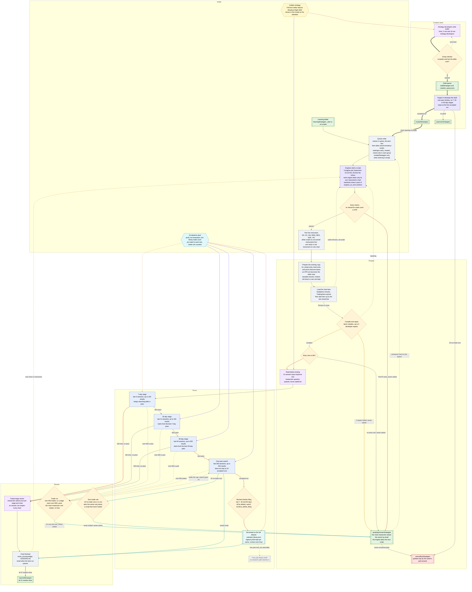

# How a script is researched

This is the full path one Pine script takes on the desk: from the learning folder, through the
7, 30 and 90-day proving stages and the one-year search, to the Not tested list and
learnedStrategies. It also covers the creation team, which writes new scripts.

Everything here was checked against the code on 6 November 2026, including the Research workflow
Design switches added to futuresfund/learn.py that day. Each step names the code it comes from as
`file:line`. Line numbers drift when the code changes. If a line looks wrong, search the file for
the function name next to it.

The same map is drawn in the desk's **Research workflow Design** tab (rail entry
`# research workflow design`). The tab and the diagram below use the same node names, so you can
read one beside the other. The tab also shows live engine status, the impact of recent changes,
and the settings you can edit.

Contents

1. [The goal](#1-the-goal)
2. [The flowchart](#2-the-flowchart)
3. [The cast: agents and engines](#3-the-cast-agents-and-engines)
4. [Step by step](#4-step-by-step)
5. [The acceptance rules](#5-the-acceptance-rules)
6. [How the search chooses and judges each change](#6-how-the-search-chooses-and-judges-each-change)
7. [Where changes are not weighed against the goal](#7-where-changes-are-not-weighed-against-the-goal)
8. [Ideas to simplify the workflow](#8-ideas-to-simplify-the-workflow)
9. [What a restart does mid-study](#9-what-a-restart-does-mid-study)
10. [The creation-team path](#10-the-creation-team-path)
11. [The golden strategy](#11-the-golden-strategy)
12. [What the old version of this document got wrong](#12-what-the-old-version-of-this-document-got-wrong)
13. [How to edit this process](#13-how-to-edit-this-process)

---

## 1. The goal

The desk wants scripts that:

- **make a profit**,
- **keep the drawdown low**, and
- **trade often enough**: the trade count on the strategy library page, pro-rated to each test
  (60 a year is about 1.2 trades a week, so 2 on the 7-day test).

The main focus is delta volume breakout scripts. The desk wants one that clears the goal on
every instrument.

In the code the goal is one function, `objective.acceptance_misses`
(futuresfund/objective.py:970-1046). It returns the rules a run misses. A run that misses
nothing passes. The proving stages use the same function with the boxes pro-rated to the stage's
share of a 260-session year, `objective.stage_bars(days)`. The table in
[section 5](#5-the-acceptance-rules) gives every number, and the strategy library page shows them
live in the table "What each test needs".

**The trade count counts trades, not trading days.** A test's fewest trades are the library count
times its share of the year, rounded up. With 60 trades a year a 7-day test passes on 2 trades,
both taken on Monday. Nothing in the code measures how many different days a script trades. The
old 3-trades-a-week floor is now an optional setting, `stage_trades_per_week`, off (0) by default.

**Passing is not the same as what the search aims for.** The search decides each next change
with several other judges (scale marker, climb rules, a ranking with win rate first). They do not
all point at the goal above. [Section 6](#6-how-the-search-chooses-and-judges-each-change)
explains them and [section 7](#7-where-changes-are-not-weighed-against-the-goal) lists where
they disagree.

---

## 2. The flowchart

The node names (`learning`, `queue`, `stage7` and so on) are the same ids the Research workflow
Design tab uses in futuresfund/static/workflow_catalog.json. Arrow styles:

- solid arrow: the main path
- red: the script fails or is parked
- amber dashed: a loop back, the engine takes another script
- cyan dotted: the acceptance goal is checked here
- gold dotted: the golden strategy is shown to the model here
- violet thick: the creation team
- gray dashed: a path that exists in code but cannot be reached today



---

## 3. The cast: agents and engines

### One model for everyone

Every desk agent runs on the same local model. Each agent has its own alias, but every alias
points at `futures-qwen38`, built from `smtek/Qwen3.8-27B:Q5_K_M` with
futuresfund/models/Qwen38.Modelfile and served by Ollama at `FUTURES_OLLAMA_URL`
(http://host.docker.internal:11434 in docker-compose.yml). The context is 40,960 tokens. The
environment variables `FUTURES_LLM_BASE` and `FUTURES_LLM_<ID>` can point an agent at another
model. Code: futuresfund/llm.py:20-57, 66-96, 372-389, 456-504.

Important: **the model does not pick the next setting in a search.** The search is mechanical
([section 6](#6-how-the-search-chooses-and-judges-each-change)). The model only answers
queued questions, writes entry rules, repairs scripts that do not compile, writes descriptions,
writes new scripts, and writes the result email.

### Agents

| Agent | Model alias | What it does in research | Code |
|-------|-------------|--------------------------|------|
| **Chart researcher** | desk-researcher, thinking pass on | One seat shared by all three charts. Posts what each chart is testing, every attempt, every stage pass or fail, and the inputs that changed nothing. Answers four kinds of queued question: **read** (first read of a script), **repair** (an exit or input does not work), **stall** (3 identical results) and **stageN** (a failed stage, also 365). Answers are saved and used the next time a chart opens the script. Files a finished script to learnedStrategies. While it researches a script it also converts an ATR exit to the dollar stop and cuts the trades of a script over the trade cap (step 14a), and it **writes the question for the owner** when a script cannot go on (step 24). When the owner's answer comes back it makes the change itself (values, the desk trade limits, the owner's pasted script, a retry or park) and the chart developer reruns the backtests. | futuresfund/roster.py:61-74, 267-272; futuresfund/learn.py:2344-2499, 3864-4010; futuresfund/attempt_reason.py:388-420 |
| Researcher decision worker (thread `chart-researcher`) | Chart researcher model, urgent lane | A priority queue of researcher questions: stage reviews first, urgent repairs next, then the rest. One question of each kind waits per script. Runs one question at a time. Nothing in the API shows this queue. Each question may take up to 1,200 seconds (`DECISION_TIMEOUT`). | futuresfund/learn.py:2348-2414; futuresfund/attempt_reason.py:31-34 |
| **2min chart developer** | desk-developer, thinking pass on | Owns the 2m engine of every instrument: 1 ES, 5 GC, 8 NQ, 11 MNQ, 14 MES, 17 M2K, 20 YM. Each takes the next script its own instrument still needs on 2m, posts every change made to the working copy, parks unrunnable scripts, writes a missing entry rule with its model, repairs a script that does not compile with its model, and files accepted year runs on the Not tested list. Only the three chart developers can file. | futuresfund/roster.py:197-209; futuresfund/learn.py:1493-1649, 4267-4419, 5260-5394 |
| **5 min chart developer** | desk-developer-2, thinking pass on | Same duties on the 5m chart of every instrument, on **seven** engines (2, 6, 9, 12, 15, 18, 21). They share one status line, so use the engine rows and the posts ("Engine 9 (NQ 5-minute) ...") to tell them apart. | futuresfund/roster.py:210-222, 277-345 |
| **15 min chart developer** | desk-developer-15, thinking pass on | Same duties on the 15m chart of every instrument, on engines 3, 7, 10, 13, 16, 19 and 22. | futuresfund/roster.py:223-235, 277-345 |
| **Trading Analyst** | desk-analyst, thinking pass on | For every study it writes a "How this script works" description on a side thread. When the Script checker accepts it, the description is written above the script in the file on disk, if the file has not changed since. Posts a line for every year attempt and a library notice when a chart finishes. | futuresfund/learn.py:4192-4228, 5235-5240, 5409-5440; futuresfund/script_brief.py:25-73 |
| **Script checker** | desk-script-checker (model only for the description check) | Checks the Trading Analyst's description against the code. Checks every creation-team draft before engine 4 sees it, mechanically: it must compile and must have the delta volume breakout core. | futuresfund/script_brief.py:43-73; futuresfund/strategy_team.py:1573-1641 |
| **Creation tester** | desk-creation-tester, thinking pass on | Owns engine 4. Develops each queued draft on the one-year window. With no draft queued, Hold on, or after Restart on engine 4, it studies a learning script with the full pipeline on any (instrument, chart) pair no chart engine has claimed, but its year runs are never filed and it has no loss stop. Posts the validation result of every chart's compile repair (a mechanical check, not a model review). | futuresfund/strategy_team.py:1690-1951; futuresfund/learn.py:1234-1280, 499-523 |
| **2min, 5 min, 15 min strategy developers** | desk-strategy-developer-2, -5, -15, thinking pass on | One writing thread per chart while research runs and Hold is off. Each writes a delta volume breakout script for the next instrument that has no accepted delta result, from the strategy cards, the library and the golden strategy. | futuresfund/strategy_team.py:1532-1669, 1235-1388 |
| Lesson writer | desk-lesson-writer (no model call in research) | Records each draft's fate in researchNotes/creation_lessons.json: sent back, queued, promoted, unproven or scrapped. LESSONS.md upkeep is mechanical. | futuresfund/strategy_team.py:1409-1417, 1623-1667; futuresfund/learn.py:3408-3434 |
| Card keeper | desk-card-keeper (no model call in research) | Receives "Added N indicators" posts. The card builder has no caller: strategy developers read a fixed researchNotes/strategy_cards.json. | futuresfund/strategy_team.py:53-116, 1560; futuresfund/learn.py:4833-4847 |
| Risk Manager | desk-risk (no model call in research) | Posts a report for every year attempt and a risk suggestion about the most common problem in the last hour (GET /api/risk-suggestions). Says nothing during the 7/30/90 stages, because stage attempts are not documented. | futuresfund/learn.py:5220-5234; futuresfund/risk_style.py:117-123 |
| Systems Administrator | desk-systems (model only for desk chat) | Receives engine faults ("Engine N problem while running ..."), keeps the error journal and runs start, stop, hold and release requests. Its engine watch and "move created strategies" duties have no caller in production. | futuresfund/learn.py:600-614; futuresfund/engine_watch.py:109-171, 511-521 |
| **Portfolio Manager** | desk-portfolio, no thinking pass | Writes the research result email with its model **on the chart thread**, so that engine waits for the model. Only the SMTP send runs on its own thread. Also sends the library ratio emails. Chairs the 8:00am and 5:00pm meetings, which pause research. **Carries the researchers' questions to the owner** on its own outbox and inbox threads: one email a minute at most, a digest when several wait, reads the replies and hands each answer to the researcher who asked (step 24). | futuresfund/questions.py; futuresfund/learn.py:4570-4576, 5838-5915; futuresfund/mailer.py:109-118; futuresfund/session.py:513-533 |
| "Strategy developer" (label on engine 4) | none | The researcher name passed to engine 4's draft search. Its posts land under this name, which is not a roster seat. | futuresfund/strategy_team.py:31, 1770-1784 |
| System | none | Author of the research start and stop messages. | futuresfund/learn.py:1162-1180, 1318-1353 |
| Ingestion | desk-ingestion | Outside the research loop. Records each TradingView alert bar, which research later appends after the downloaded bars. | futuresfund/ingestion.py:21-103; futuresfund/research_bars.py:48 |

Not in research: Quantitative Trader, Floor Trader (they run the live strategies on their own
trading engines) and Compliance & Operations (drawdown, daily loss limit, 4:45pm flatten).

### Engines and machinery

| Engine | Chart | What it does | Code |
|--------|-------|--------------|------|
| **Engines 1-3** | ES 2m, 5m, 15m | The ES chart engines. Each is a logical engine: its own thread, status card, queue, Skip and Restart. It studies only ES on its own chart. | futuresfund/roster.py:277-345; futuresfund/backtrader_engine.py:560-650 |
| **Engine 4** | none fixed | The creation engine (`roster.CREATION_ENGINE_ID`, slot 3). Develops drafts, or studies a learning script on any (instrument, chart) pair no chart engine has claimed when there is no draft, Hold is on, or Restart was pressed. | futuresfund/strategy_team.py:1892-1951; futuresfund/learn.py:1462-1522 |
| **Engines 5-22** | three per instrument | 5-7 GC, 8-10 NQ, 11-13 MNQ, 14-16 MES, 17-19 M2K, 20-22 YM, each 2m, 5m and 15m. Generated from `roster.ENGINE_ROOTS`, a fixed list, so engine numbers never shift while the desk runs. Two instruments' engines on one timeframe can study the same file at the same time. | futuresfund/roster.py:277-345 |
| Worker pool | shared by all 22 | `engine_workers.EngineDesk`. The logical engines run their backtests on at most `engines_at_once` worker processes (default one per core but one, at least 2). A worker starts when a backtest needs one, keeps the bars of two charts, and a job goes to a free worker that already holds its chart first. An engine waiting for a worker shows "Waiting for a free worker (N running at once)". Skip of a waiting engine drops its queued job; Skip or Restart of a running engine ends the worker that runs it, and that worker starts again on its next job. A chart engine sends a worker only the last year plus 2,000 warm-up bars (`research_window`); tests/test_engine_pool.py proves the result is the same as with the whole series. | futuresfund/engine_workers.py; futuresfund/backtrader_engine.py:1126-1180 |
| PineTS Node server | one per worker | `node pinets_run.mjs --serve`, restarted after a run passes 600 seconds (`RUN_SECONDS`) or after 300 backtests (`SERVER_RUNS`). | futuresfund/pinets_engine.py:29-36, 223-260 |
| Backtest executor | the chart's engine | `_engine_execute` builds the function every search calls. It applies the contract's point value and maps inputs by label. Stage runs get 2,000 warm-up bars; year runs do not. | futuresfund/learn.py:4739-4818; futuresfund/backtrader_engine.py:39, 1077-1178, 1200-1243 |
| Desk compiler | chart thread | The compile gate: `pine_check.tv_problems` plus `pine_runtime.compile_pine`. It is not PineTS. A 600-bar PineTS dry run is used only to validate a repair. | futuresfund/strategy_team.py:476-543 |
| Input response probe | the chart's engine | Runs the script at its own settings on the last 21 sessions, then moves each input to about a quarter and 4 times its value, up to 40 runs. Inputs that change nothing are left out of the search. | futuresfund/script_diagnosis.py:24-30, 99-192 |
| Search planner | chart thread | `_search` and `_search_inputs`. Picks every attempt's settings without the model. | futuresfund/learn.py:2510-3086 |
| Proving stage driver | the chart's engine | `_prove_stages`. Runs 7, 30 and 90 days in order and writes the proving ledger. | futuresfund/learn.py:4066-4135 |

---

## 4. Step by step

Each step lists what happens, the decisions and where they lead, who does it, the files, the
settings that govern it, and the code. "Editable" settings are the ones in the Research workflow
Design tab, shown with their key, default and range. Everything else is fixed in code.

The research path is steps 1 to 23, and step 24 is the questions the researchers send the owner. Restarts are [section 9](#9-what-a-restart-does-mid-study)
and the creation team is [section 10](#10-the-creation-team-path). Together they cover all 25
steps of the code map plus the two the review added (the recheck and the zero-trade park):

| Code-map step | Here | Code-map step | Here |
|---------------|------|---------------|------|
| place-script | Step 1 | search-loop | Step 14 |
| queue-order | Step 2 | skip-window | Step 15 |
| engine-claim | Step 3 | failed-stage-review | Step 16 |
| pre-test-checks | Step 4 | year-search | Step 17 |
| pick-instrument | Step 5 | (added) recheck | Step 18 |
| working-copy | Step 6 | filing-during-search | Step 19 |
| load-bars | Step 7 | (added) zero-trade rule | Step 20 |
| compile-repair | Step 8 | chart-finished | Step 21 |
| entry-rule | Step 9 | file-learned | Step 22 |
| executor | Step 10 | five-year-shelf | Step 23 |
| read-before-testing | Step 11 | restart-mid-study | Section 9 |
| proving-stages | Step 12 | creation-write | Section 10, C1 and C2 |
| search-setup | Step 13 | creation-engine4, creation-to-charts | Section 10, C3 and C4 |

### Step 1. Script placed in learningStrategies (node `learning`)

**What happens.** Any `.pine` file, or a `.txt` file with `//@version` or `strategy(` in its first
40 lines, is a job. A python twin (`<stem>.py` or `<stem>_strategy.py`) is studied with its Pine
file, not as a second job. Folder listings are cached by folder modified time. The file stays in
learningStrategies until every instrument has a result on all three charts.

**Decisions.**
- Not a script by the rules above: not a job.
- If no chart file has a volume column, every script that mentions `volume` is left out of every
  queue for this run, and each chart developer posts that note.

**Agents.** The three chart developers. **Engines.** None.

**Files.** futuresfund/learningStrategies/ (read). futuresfund/researchNotes/<stem>.json (read).

**Settings.** Fixed: the volume rule. Nothing editable.

**Code.** futuresfund/learn.py:20, 985-1044, 1099-1114, 1400-1416.

### Step 2. Queue order (node `queue`)

**What happens.** Every chart sorts the learning scripts by this key, in this order:

1. its position in researchNotes/queue_first.json (names not listed come after all listed ones);
2. delta volume breakout scripts before the rest (`delta_core.has_core`: the text has a POC, a
   delta and a volume profile pattern);
3. inside each group, a researcher's redesign first;
4. inside each group, a name starting with `created_` last;
5. then the name, lowercase.

Then `jobs_for_chart` keeps only the scripts that still have an open instrument on this chart and
are not held or claimed. Only when no learning script is left for this chart does the chart take
createdStrategies scripts. Those must not be in development on engine 4 and must have one run
that passed acceptance in their notes.

queue_first.json is read again whenever it changes. Today it lists 10 names.

**Decisions.**
- Named in queue_first.json: first, in file order.
- Delta core: ahead of the rest.
- `created_` prefix: behind, but only inside its group. A `created_` delta script still goes
  ahead of an original that is not a delta script.
- No learning script open on this chart: createdStrategies scripts that passed engine 4.

**Agents.** Chart developers. **Engines.** None.

**Files.** futuresfund/researchNotes/queue_first.json, futuresfund/learningStrategies/,
futuresfund/createdStrategies/ (all read).

**Settings.** Editable: the queue order itself, in the Queue node's inspector in the tab. Saving
writes researchNotes/queue_first.json (POST /api/workflow-design/queue). Fixed: the delta,
redesign and `created_` rules.

**Code.** futuresfund/learn.py:1037-1080, 792-815, 373-397, 130-133, 710-716;
futuresfund/delta_core.py:44-48; futuresfund/redesign.py:46-47.

### Step 3. An engine claims the script (node `claim`)

**What happens.** Every instrument has three chart engines, one each for 2m, 5m and 15m:
engines 1-3 are ES, 5-7 GC, 8-10 NQ, 11-13 MNQ, 14-16 MES, 17-19 M2K and 20-22 YM. Engine 4 is
the creation engine. The table is `roster.ENGINE_DESKS`, generated from the fixed
`ENGINE_ROOTS = ("ES", "GC", "NQ", "MNQ", "MES", "M2K", "YM")`. The three chart developers keep
their timeframe, so each owns seven engines, and every post names the engine and its instrument
("Engine 9 (NQ 5-minute) is taking ...").

Each chart engine runs its own loop (`developer_loop`) with its root and timeframe. Each pass first
runs `file_completed_soon`, which files scripts that already finished every chart at most once a
minute across all 21 loops (one shared timestamp and lock), not 21 times per pass. Then
`JobClaims.take(root, timeframe)` scans the folders outside its lock (the scan stats every file, which
is slow on the desk's bind mount), then claims, under one lock, the first script from
`jobs_for_chart(timeframe, root=...)` that still needs **this instrument** on this chart and is not
held, parked or claimed for this (file, chart, instrument). So two instruments' engines on the
same timeframe can study the same file at the same time, while one instrument's chart is only ever
open on one engine. `_study(..., root=)` passes the root to `_study_chart`, which studies only that
instrument (it returns at once if the root is no longer pending) and loads only that chart.

The backtests themselves run on a bounded pool of worker processes (`engine_workers`): at most
`engines_at_once` at a time, so 22 engines do not mean 22 CPU-bound processes on the desk's 8
cores. A worker starts when a backtest needs one and keeps the bars of two charts; a job goes to a
free worker that already holds its chart first. An engine waiting for a worker shows "Waiting for
a free worker (N running at once)" on its card. A chart engine sends a worker only the last year
and the 2,000 warm-up bars before it, which gives the same result as the whole series.

Engine 4 also takes learning jobs: after Restart on engine 4, while Hold is on, or when no draft is
queued. It then runs as the Creation tester and goes through every (instrument, chart) pair, an
instrument without engines of its own (a new chart folder) first. It claims through the same
`JobClaims`, so it never opens a chart an engine already has. Nothing holds or parks a script it set
aside (for example one with fewer than 80 bars), so it can take the same script again on its next
loop.

**Decisions.** What the loop does with the study's outcome:
- `repairing`: the whole file is held (a compile failure is the file's, not one chart's), the
  failure is counted once for the file, and the engine takes the next job. One repair runs per
  file; the engine that started it picks up the validated script, and the hold is released for every chart.
- `busy` (another chart is writing its entry rule): held on this instrument's chart, tried again later.
- `skipped`, `engine`, `failed`, `blocked` or an exception: parked on this instrument's chart until research restarts.
- `cannot_run` (parked) or `awaiting` (the researcher asked the owner and the file waits in
  awaitingAnswerStrategies): nothing more to do, the file has moved, and the engine takes the next script.
- No job: pick up a validated repair, give a held script one more turn (`release_retries`, fewer
  than 2 failures for that file), or sleep 20 seconds.
- All workers busy: the engine waits for a free one. Skip while it waits drops the queued job.
- The `waiting` branch in the loop is dead code: `_study_chart` never returns it.

**Agents.** Chart developers, Chart researcher ("X is studying ... engine N"), Creation tester for
engine 4. **Engines.** E1 to E22.

**Files.** futuresfund/learningStrategies/.

**Settings.** Editable: `engines_at_once` (node `claim`), the backtests that run at the same time.
Fixed: the engine table (`roster.ENGINE_ROOTS`, `ENGINE_DESKS`), the two charts a worker keeps
(`engine_workers.CHARTS_PER_WORKER`), the once-a-minute filing pass (`learn.FILE_COMPLETED_EVERY`),
the 20-second idle sleep, the retry limit of 2.

**Code.** futuresfund/roster.py:277-345; futuresfund/learn.py:1599-1937, 675-711, 1462-1522,
5330-5360; futuresfund/engine_workers.py; futuresfund/strategy_team.py:1892-1951.

### Step 4. Early checks (node `prechecks`)

**What happens.** `_study_chart` checks, in order:

1. Not a strategy file: stop.
2. The file is no longer in learning or created (another chart moved it): leave it.
3. Nothing pending on this chart: file the script if every chart is done, else stop.
4. Instruments that another copy of the same script already finished are dropped.

A script is **not** refused for its trade count any more. Before this change, notes with more
than 900 trades on any chart or instrument parked the script for every chart. Now
`objective.chart_over_cap(notes, root, timeframe)` reads only this instrument and timeframe (the
notes' `over_trade_charts` entry and that chart's trials), and when it is over 900 the study
starts in the trade cut (`learn._start_cut_from_notes`, step 14a). Scripts already parked in
cannotRunStrategies for 900 trades are not brought back.

An ATR exit is **not** refused here any more. Step 6 converts it to the dollar stop, and the
script is studied like any other. (Before this change, `atr_exit` parked it in
cannotRunStrategies without a single backtest. Scripts already parked there for that reason are
not brought back.)

When another chart moved the file, the chart says where it went (`learn._left_text`): parked in
cannotRunStrategies, waiting in awaitingAnswerStrategies for the owner's answer, or filed in
learnedStrategies. A script whose own settings raise in PineTS on attempt 1, or that PineTS cannot
run, is not parked either: the chart researcher asks the owner (question kind `unrunnable`, step 24).

**Decisions.** Passes: `instrument`. Nothing is parked here. A PineTS stop on attempt 1: `awaiting`.

**Agents.** Chart developers. **Engines.** None.

**Files.** futuresfund/researchNotes/<stem>.json (read).

**Settings.** Fixed: `objective.TRADE_SAVE_MAX = 900`. Nothing editable here; the trade cut has
`trade_cut_attempts` (step 14a).

**Code.** futuresfund/learn.py:4267-4306, 734-770; futuresfund/objective.py:804-841.

### Step 5. Pick the instrument (node `instrument`)

**What happens.** The instrument is the engine's: each chart engine studies only its own root,
so engine 8 studies only NQ 2m, and a study whose root is no longer pending on that chart returns
at once. **One study covers one instrument on one chart**, so each script needs 7 × 3 = 21
studies, and the 21 chart engines can run them at the same time (as fast as `engines_at_once`
workers allow). The instrument order (ES, then GC (QO when GC has no download), NQ (always
listed), MNQ and MES when their folders exist, then every other chart folder) still decides which
instruments a script is tested on. Only a study without a root (an older caller) picks one itself:
a delta volume breakout script moves the instruments that have no **accepted** delta result yet
(from any delta script) to the front, a scoreboard cached for 300 seconds, and the study takes the
first instrument on the list.

**Decisions.** Chart engine: its own root, or return when it is no longer pending. No root: delta
script uncovered instruments first, otherwise research order.

**Agents.** Chart researcher posts "Testing <file> on the <chart> <instrument> chart".
**Engines.** None.

**Files.** futuresfund/researchNotes/*.json (scanned for the delta scoreboard).

**Settings.** Fixed: the instrument order, `delta_core.COVERAGE_SECONDS = 300`
(futuresfund/delta_core.py:32). Nothing editable.

**Code.** futuresfund/learn.py:149-164, 4298-4320; futuresfund/delta_core.py:81-148.

### Step 6. Prepare the working copy (node `copy`)

**What happens.** The study runs on a prepared copy:
`prepare_backtest(promote_fixed_pivots(promote_fixed_exits(repair_dead_entry(text))))`.

- `repair_dead_entry` fixes an entry check that can never pass, such as `ta.highest(volume, ...)`
  compared with the current volume, and broken cooldown stamps.
- `promote_fixed_exits` and `promote_fixed_pivots` turn a literal stop, target or pivot length
  into inputs the search can move.
- `prepare_backtest` adds the standard session (`ensure_session`: `use_session`, `sess_start_hr`
  18, `sess_end_hr` 16 and so on, all searchable). It also wraps the entries in `if in_session`
  and strips futures-only gates. That is a logic change, not just new inputs.
- `convert_atr_exit` (futuresfund/strategy_team.py, with the reader in futuresfund/atr_exits.py)
  converts an exit set with ATR to the dollar stop. It is never refused.
  - It finds only ATR that feeds an exit: the names a `strategy.exit` `stop=`, `loss=`,
    `limit=`, `profit=`, `trail_price=`, `trail_points=` or `trail_offset=` reads, and the
    variables assigned to them (`stop_dist`, `sl_dist`, `current_stop := close - sl_dist`, an
    inline `close - atr_val * stop_mult`, `math.min(stop_atr * atr, ...)`). ATR in a signal
    (SuperTrend bands, a Keltner channel, a gap size) is left alone. SuperTrendSTRATEGY has no
    `strategy.exit`, so it is not an ATR exit at all. A variable a signal also reads, directly or
    through the variables assigned from it, keeps its ATR whatever its name (`atr_exits._signal_reads`):
    a `long_stop_line` the entry crosses, or a SuperTrend level that feeds a `trail` the trend reads.
    An exit call, a drawing (`plot`, `label.new`), a warm-up guard `na(sl_dist)`, and an `if` block that
    only moves the stop (no `strategy.entry` inside) do not count as signals.
  - Engine 4's draft is converted on its own contract (`research_rules.chart_root(root)` around the
    conversion in `strategy_team.handoff`), so a micro draft is saved with the $50 stop and $100 target.
  - The stop distance becomes `stop_dollars / pv`, an ATR take profit becomes `tp_dollars / pv`,
    and a target that is a ratio of the stop (`sl_dist * tp_sl_ratio`) stays. `loss=` and the
    other tick arguments get `/ syminfo.mintick` when the script did not divide by it. The
    script's exit structure stays: break-even, trail, reversal, re-sent exits. Only the distance
    changes.
  - It declares `pv` and `stop_dollars = input.int(D, "Stop ($)", minval=50, maxval=700,
    step=10)` above the first line that reads them, plus `tp_dollars` (step 10) when a target
    needs it. D is the desk's opening value: $250 and $500 on a full contract, $50 and $100 on
    a micro. It adds the open-loss close at `stop_dollars`, so the stop always holds.
  - Multiplier inputs (`stop_mult`, `tp_mult`, `sl_atr_mult`, `stop_atr`, ...), the ATR length,
    `ta.atr` and a dollar cap such as `max_loss` are removed when nothing else reads them. A
    multiplier a label still reads becomes a fixed value, so the search never measures it as a
    dollar stop.
  - It runs inside `prepare_backtest` (so `script_as_run`, the `engine_problem` dry run and
    engine 4's drafts all get it) and inside `repair_pine` (so a researcher rewrite that brings
    in an ATR exit is converted, not refused). `script_as_run` hands `merge_risk` the converted
    text, so the converted stop is not replaced by the $700 default. Running it twice changes
    nothing.
  - The developer posts "<file> set its exit with ATR. Converted the ATR exit to a $250 stop that
    always holds ... A fill past the stop on a gap or thin volume is accepted." The notes keep
    that sentence under `exit_conversion` (top level and on the chart record).
  - A fill past the stop is accepted in research while the stop setting is $750 or less
    (`objective.trade_loss_ok`). The live and paper broker still clamp a gap loss at the dollar
    stop (`tv_broker._loss_floor`); that is unchanged.
- `ensure_risk_management` then has three branches (a converted script takes the first or the
  second, never the third):
  1. a script with its **own exit** keeps it, with an open-loss close at its dollar stop;
  2. a script that already has a dollar stop keeps that stop and take profit;
  3. any other script gets the shared RISK block: `stop_dollars` 250 (50 to 700), `tp_dollars`
     500, trailing stop off.
- `repair_for_pine` fixes what PineTS cannot read.

The developer posts each change. Then two side jobs start: the Trading Analyst writes a
description of the script (written back to the file on disk only when the file still matches the
text described), and the script's indicators are filed in the indicator library.

**Decisions.** ATR exit: convert the distance to the dollar stop, keep the rest of the exit. Own
exit: keep it with an open-loss backstop. Has a dollar stop: keep it. Otherwise: shared stop and
take profit, trail off.

**Agents.** Chart developers, Trading Analyst, Script checker (checks the description), Card
keeper (log only). **Engines.** The model, on a side thread, for the description.

**Files.** futuresfund/learningStrategies/<file> (only the description is written back);
the indicator library in futuresfund/researchNotes/.

**Settings.** Fixed: the RISK block defaults (futuresfund/strategy_team.py:376-397), the session
defaults, the converted stop's opening values (`research_rules.stop_ladder` and
`opening_target`). Nothing editable.

**Code.** futuresfund/learn.py:4321-4368, 4192-4228, 4615-4695, 4833-4847;
futuresfund/entry_rules.py:339-357; futuresfund/strategy_team.py:302-314, 352-363, 918-1007.

### Step 7. Load the chart bars (node `bars`)

**What happens.** `_load_frames(root, timeframes=(timeframe,))` builds only this engine's chart,
once, at the start of the study (the other two timeframes are not read). When a Databento minute download exists, its minutes are folded to the chart width,
TradingView export bars replace the bars they cover, and the TradingView alert candles after the
download's last bar are added up to the last closed bar. That alert tail is re-read at most every
900 seconds. Without a download, the TradingView exports are used, filled from 1-minute export and
alert candles where every minute exists.

Each backtest later cuts its window inside the engine: the last 260 sessions for the year, or the
stage's sessions plus 2,000 warm-up bars, where only trades that enter inside the window count. A
chart engine sends its worker only those bars: the last year and the 2,000 bars before it
(`backtrader_engine.research_window`). The result is the same as with the whole series
(tests/test_engine_pool.py checks it, and it was checked on the ES 15m, GC 5m and MNQ 2m charts).
A series that is a year or shorter, or whose times are not whole numbers in time order, is sent
whole. The creation engine's five-year runs send everything.

**Decisions.**
- 80 bars or more on this chart: go on to `compile`.
- Fewer than 80: the developer posts it and the study returns `skipped`. This chart parks the
  script for the rest of the run (loop back to `claim`).

**Agents.** Chart developers. **Engines.** None (bar building).

**Files.** Databento minute files and cache, TradingView exports in each chart folder,
~/.futuresfund/live_bars/ (alert candles). All read.

**Settings.** Editable:
- `use_alert_bars` (default on): add the TradingView alert bars after the download.
- `live_refresh` (default 900 s, 60 to 3,600 in steps of 60): how often the alert tail is re-read.

Fixed: the 80-bar minimum, `backtrader_engine.WARMUP_BARS = 2000`
(futuresfund/backtrader_engine.py:39), `objective.RESEARCH_SESSIONS = 260`.

**Code.** futuresfund/learn.py:4369-4379, 4850-4854; futuresfund/research_bars.py:29, 47-136;
futuresfund/backtrader_engine.py:1077-1110; futuresfund/objective.py:116-119.

### Step 8. Compile and repair (node `compile`)

**What happens.** `repair_for_pine` first declares missing names and replaces `math.min` and
`math.max`, up to 12 passes, on the copy. Then the desk compiler checks it (`tv_problems`, then
`compile_pine`), and `pine_runtime.supported` must be true. This gate is the desk compiler, not
PineTS.

A failure calls `send_to_repair`. If the script already had 3 failed repairs, the chart researcher
asks the owner (question kind `compile`, step 24) and the script waits in awaitingAnswerStrategies.
Otherwise one background repair starts for this file (whichever of the 21 engines found the error,
keyed by the file, not the developer), and the researcher emails the error at
once (kind `repair`, the file stays put): a fixed script from the owner replaces the file, and
other words reach the developer as a hint for its next repair (`questions.repair_hint`). The whole
file is held while it is repaired, so no other engine opens it, and the failure is counted once for
the file. A rejected repair gets one more turn (`release_retries`, fewer than 2 failures), then
stays held until research restarts. Two of one developer's engines can each have a repair running
for different files at the same time. The repair applies `repair_for_pine`, then the developer's model rewrites the script
(`repair_with_developer`), then legal defaults are set. The Creation tester validates it
mechanically: it must compile and pass a 600-bar PineTS dry run on ES 5m. A valid repair saves the
original in researchNotes/script_originals/ and **writes the repaired copy over the file in
learningStrategies**, unless the file changed while the repair ran (the owner emailed a fixed
script): then the repair of the old text is dropped and the owner's script stays. The engine moves on, and picks the script up again once the repair is
validated.

The repair counter is kept in memory, so it starts at 0 again after a restart.

**Decisions.**
- Compiles: go on to `entry`.
- Fails, fewer than 3 repairs: repair on a side thread, engine takes the next script (loop back to
  `claim`).
- Fails after 3 repairs: the researcher asks the owner, `awaiting`.

**Agents.** Chart developers (their model writes the repair), Creation tester (validates), Chart
researcher (emails the error and asks the owner).
**Engines.** The model plus a PineTS dry run.

**Files.** futuresfund/learningStrategies/<file> (overwritten by a validated repair),
futuresfund/researchNotes/script_originals/, awaitingAnswerStrategies/.

**Settings.** Editable: `compile_repair_tries` (default 3, 0 to 10). At 0 the researcher asks the
owner at once. Fixed: `strategy_team.DRY_RUN_BARS = 600`
(futuresfund/strategy_team.py:1074), the 12 automatic passes.

**Code.** futuresfund/learn.py:4380-4400, 428-597; futuresfund/strategy_team.py:476-543;
futuresfund/attempt_reason.py:569-575.

### Step 9. Entry rule (node `entry`)

**What happens.** The desk needs an entry rule for the script before it is studied. The rule is
ready when PineTS supports the script, when the title is built in or has a saved file in
futuresfund/entryRules/, or when the generic parser can find the long and short conditions.
Otherwise the developer's model writes a Python rule (2 tries). Only one chart writes a given
rule at a time.

**Decisions.**
- Ready: go on to `read`.
- Another chart is writing it: `busy`, the script is held and tried again.
- The rule could not be written: the researcher asks the owner (kind `entry_rule`), `awaiting`.

**Agents.** Chart developers. **Engines.** The model, only when a rule must be written.

**Files.** futuresfund/entryRules/<title>.py (written).

**Settings.** Fixed. Nothing editable.

**Code.** futuresfund/learn.py:4401-4419; futuresfund/entry_rules.py:36-81, 117-155, 181-218.

### Step 10. Build the executor and starting settings (part of node `read`)

**What happens.** `_engine_execute` wraps the PineTS run for this study. Every run applies the
contract's point value, applies a session window when the plan carries one, and maps inputs by
label. The starting settings are every numeric, true/false and choice input at the script's
default, with the contract's point value. **Every chart starts from the script defaults**, not
from another chart's best.

**Agents.** Chart developers. **Engines.** The chart's engine.

**Settings.** Fixed: `FROZEN` inputs the search never moves (capital, point value, tick size,
commission, slippage, quantity, pyramiding and so on; futuresfund/learn.py:41-53).

**Code.** futuresfund/learn.py:4420-4421, 4698-4817; futuresfund/backtrader_engine.py:1200-1240.

### Step 11. Read before testing (node `read`)

**What happens.** One record per script is kept in researchNotes/script_diagnosis/. Its key
ignores comments and the point value, so every chart and instrument shares it.

1. If another chart holds this script's lock, this chart uses the saved record, drops the inputs
   it found ignored, and goes on.
2. If a researcher answer is waiting, it is used now, once. Answer settings are merged into the
   starting settings **without being measured**. An answer script is measured on 21 sessions and
   kept only when it holds.
3. If the record has no baseline that traded, the input response test runs on the last 21
   sessions: one baseline, then each input at about 0.25 and 4 times its value (exits first,
   session inputs last), up to 40 runs. Inputs whose profit, drawdown and trades never change are
   "flat". Inputs nothing reads are "unread". Both are left out of every search of this script.
4. A question for the researcher is queued and the study goes on at once:
   - no read yet: a **read** question (values only);
   - read already and an exit or input still faulty (fewer than 3 repairs): a **repair** question,
     whose answer may **rewrite** the script even with values-only on;
   - no trades yet and fewer than 3 empty charts: wait for a chart that trades;
   - no trades on 3 charts: ask why the script never enters.

When an answer arrives, `_decide` saves it and calls `_reopen_for_answer`: every chart's results
for the script are moved to researchNotes/before_repair/ and cleared, so all 21 studies run again
(at most 3 times per script). A script already in learnedStrategies is moved back.

If anything in this step throws an error, it is swallowed and the study goes on with the defaults.

**Decisions.** See the list above. In every case the next step is `stage7`.

**Agents.** Chart researcher (and its decision worker). **Engines.** The chart's engine (up to 41
runs on 21 sessions) and the model (async).

**Files.** futuresfund/researchNotes/script_diagnosis/<key>.json and decisions.jsonl,
futuresfund/researchNotes/before_repair/<slug>_<n>.json.

**Settings.** Editable:
- `read_before_testing` (default on): run this step at all. Off also means a waiting researcher
  answer is not picked up, because answers are applied here.
- `response_sessions` (default 21, 5 to 64): the window of the input response test.
- `empty_charts` (default 3, 1 to 21): charts with no trades before the researcher is asked why.
- `allow_repair_rewrites` (default on): a repair answer may rewrite the script. Off makes repair
  answers values-only like the others.

Fixed: `VALUES_ONLY = True` (futuresfund/learn.py:3716), `REPAIR_TRIES = 3` for repair questions
(futuresfund/learn.py:3712), `script_diagnosis.RESPONSE_RUNS = 40`, `EXIT_SLACK = 1.5`.

**Code.** futuresfund/learn.py:4422-4433, 3864-3963, 3754-3764, 2388-2499;
futuresfund/script_diagnosis.py:24-30, 69-74, 99-230.

### Step 12. The proving stages (nodes `stage7`, `stage30`, `stage90`)

**What happens.** `PROVING_STAGES = ((7, 5), (30, 21), (90, 64))`: calendar days and futures
sessions. For each stage in turn:

1. the engine window is set to the stage's sessions;
2. the proving ledger marks the stage `testing` with its attempt budget (starting the 7-day stage
   clears passes and attempt counts from an earlier study);
3. a search runs with the stage's own budget, read by `learn.stage_attempts(days)` when the stage
   starts: up to 100 different results on 7 days (`STAGE_7_ATTEMPTS`), 150 on 30 days
   (`STAGE_30_ATTEMPTS`) and 200 on 90 days (`STAGE_90_ATTEMPTS`), with at most twice that many
   engine runs, repeats included;
4. a run that passes `stage_passed` **does not end the stage**. The search keeps going for a pass
   with more profit and less drawdown. The best pass is the one with the highest profit minus its
   max drawdown, and on a tie the lower drawdown (`learn._pass_score`, `_best_pass`). The stage
   stops when its budget is spent, or when `STAGE_PATIENCE = 25` runs in a row, repeats included,
   found no better pass (`trials.patience_stop`). A stage that never passes spends its whole
   budget.

Every attempt post says "Attempt N of M", and every stage verdict says which attempt is still the
best pass and how many of the 25 attempts without a better pass are used.

`stage_passed` is the acceptance check with the boxes pro-rated by `objective.stage_bars(days)`:
the stage's sessions out of 260 (5, 21 and 64). With the saved book values ($6,000 and 60 trades)
a stage needs more than $115 (7 days), $485 (30) or $1,477 (90), at least 2, 5 or 15 trades, and
at most 11, 48 or 147 trades (600 a year at the stage's pace). The profit factor, win rate and
stop size are the same as for the year. **The $2,500 drawdown rule is not scaled down**, on
purpose: a window's drawdown can never be larger than the drawdown of the year that holds it.
Every stage post that did not pass names the missed bar with the stage's numbers, for example
"The 7-day test needs more than $115 profit in 7 days (a $6,000 year at a steady pace). This run
made $80." A failed stage's review question carries the same bars.

When the stage ends with a pass, the settings of its **best** pass are merged into the settings and
the next stage starts from them. The ledger records that pass with a Pine copy in
researchNotes/proving/<days>_day/, plus `attempts_used`, `attempt_budget` and `best_attempt`, and
the researcher posts "passed the 7-day stage. Its best pass was attempt 12 of the 37 it used (100
allowed)". After the 90-day stage, the ledger marks 365 `testing` with the year budget and the year
search starts. The attempts each stage used and had are kept in `execute.source["stage_attempts"]`,
saved in the notes on the chart record under `stages`, and shown in the Proving table cells
("37 of 100 attempts, best #12").

**Decisions.**
- A run passes: keep searching. A better pass becomes the best pass and starts the patience count
  over.
- Budget spent, or 25 runs in a row without a better pass, with a pass: carry the best pass to the
  next stage.
- The search was cut off (Skip, Restart, the file moved, research stopped): return as `skipped`,
  no fail mark, and a pass found before that does not start the next stage.
- The whole budget and no pass: the stage fails, go to `review`. (The skip-window retry in
  between never runs, see step 15.)
- Every run had no trades: the stage ends early, the chart is counted as finished (see step 22).

**Agents.** Chart researcher, chart developers. **Engines.** The chart's engine, on 5, 21 or 64
sessions plus warm-up.

**Files.** futuresfund/researchNotes/proving/stages.json,
futuresfund/researchNotes/proving/<days>_day/<script>_<root>_<tf>.pine (written).

**Settings.** Editable:
- `stage_7_on`, `stage_30_on`, `stage_90_on` (default on): run that stage. A stage turned off
  gets no ledger mark, and the next stage starts from what passed before it.
- `stage_7_attempts` (default 100), `stage_30_attempts` (default 150) and `stage_90_attempts`
  (default 200), each 1 to 1000, on their own stage node: different results that stage gets. The
  engine-run cap is twice this. They replace the old shared `stage_attempts` (20); a saved file
  that still holds that key is read without it, and the next save drops it.
- `stage_patience` (default 25, 1 to 1000), shown on all three stage nodes: attempts in a row
  without a better pass that end a stage that has passed.
- `stage_trades_per_week` on the Acceptance goal node (default 0, off; 0 to 10 in steps of 0.5).
  Above 0 it adds that many trades for every five sessions on top of the library count, on
  **every** check, the year included.

Fixed: `PROVING_STAGES` (futuresfund/objective.py:119), the acceptance boxes (section 5).

**Code.** futuresfund/learn.py:4196-4293 (`_prove_stages`), 3797-3874 (budgets, `stage_attempts`,
`_pass_score`, `_best_pass`), 3020-3068 (the stage verdict in the search), 2927-2933 (a repeat
counts toward the patience); futuresfund/objective.py:116-131, 970-1046;
futuresfund/proving.py:115-175 (`mark` keeps `attempts`).

### Step 13. The set-up at the start of every search

This runs at the start of each stage and of the year search.

**What happens.** `_search` creates a tracker of what each input does (`input_effects.Tracker`),
and at the end writes it to researchNotes/input_effects/<script>.json and posts the inputs it
removed. `_search_inputs` then:

- turns every daily loss or profit limit off (`prepare_research`), except the desk's own
  `desk_` trade limits, which it never touches, and except on a chart whose trade cut turned the
  script's own daily limits on: those stay on at the next stage;
- puts the exits on the bottom rung (`_start_on_the_ladder`): a full-contract stop above $700
  becomes $700; on a micro contract every stop above $50 becomes $50 and every target above $100
  becomes $100;
- drops the inputs the read step found flat or unread;
- posts how it reads the script.

Because this runs again at every stage, a micro stop or target that passed a stage, and any daily
limit, are reset at the next stage, except the daily limits the trade cut turned on (step 14a).

**Decisions.** Micro contract: $50 and $100 opening exits. Daily limits: off at the start, unless
the trade cut on this chart turned them on. Desk trade limits: kept as they are.

**Agents.** Chart researcher. **Engines.** None.

**Files.** futuresfund/researchNotes/input_effects/<stem>.json (written).

**Settings.** Fixed: `research_rules.STOP_LADDER` (250, 500, 700), `TARGET_LADDER` (250 to
10,000), the micro ladders, `EXIT_DOLLAR_STEP = 50` (futuresfund/research_rules.py:22-31).
Nothing editable.

**Code.** futuresfund/learn.py:2510-2620; futuresfund/research_rules.py:115-150, 200-228;
futuresfund/input_effects.py:59-168.

### Step 14. One attempt in the search loop

This is the inner loop of every stage and of the year search. [Section 6](#6-how-the-search-chooses-and-judges-each-change)
explains how the change is chosen.

**What happens.** On each pass:

1. Stop if research was cancelled, the engine was skipped or restarted, or the file left its folder.
2. Wait while research is paused (the 8:00am and 5:00pm meetings pause it).
3. Pick the starting point: the best run that traded (after a run with no trades), else the last
   run, else the starting settings.
4. Choose a plan: the next trade cut when this chart is in the trade cut (step 14a), else the
   exit sweep, then the frequency plan, then "dead" when no run ever traded, then `next_plan`, then
   the nearest unused value from the best run.
5. Clamp it to the input's limits. Skip plans already tried, plans in a direction known to do
   nothing, and plans past a value that stopped all trades. More than 40 skips in a row ends the
   search.
6. Post the attempt and run it. (The notes are no longer re-read for a 900-trade cap before each
   attempt.)
7. A script error undoes the last rewrite (up to 5 times). A run over the trade cap is kept,
   flagged `over_cap`, and starts or continues the trade cut (step 14a); the script is not set
   aside.
8. A result identical to an earlier one (same profit, drawdown and trades) is not counted.

Attempt 1 of every stage and of the year runs the carried settings unchanged on the new window.
That is a fair first measurement, and it uses one of the stage's 100, 150 or 200 slots, or one of
the year's 300.

When the search starts, `begin_study(slot, script, goal, limit=, stage=)` tells the engine its
budget and its test (7, 30, 90, or 365 for the year). The Under the hood card and the Research
workflow engine list and tooltip show "attempt 12 of 100 · 7-day test".

**Decisions.**
- 3 repeats in a row that taught nothing: ask the researcher a stall question (once per script).
  In the year search a chart engine then leaves the script (`repeat_stop`).
- 20 repeats with no trades: stop (stages included).
- In a stage, a passing run does not end the stage (step 12). After the stage's first pass, a run
  or a repeat that does not beat the best pass counts toward `STAGE_PATIENCE`; 25 in a row end it.
- A compile, script, engine or unrunnable fault ends the search.

**Agents.** Chart researcher and chart developers post every attempt. In the year search the Risk
Manager and Trading Analyst post too. **Engines.** The chart's engine.

**Settings.** Editable: `impact_percent` (default 0.05, 0.01 to 0.5) on the year node: a profit
drop of this share or more ends a climb on an input, in stages and the year. Fixed: the 3-repeat
rule, the 40-skip rule, 5 script-error recoveries (hardcoded numbers in futuresfund/learn.py).

**Code.** futuresfund/learn.py:2621-2994, 3159-3204, 6450-6477.

### Step 14a. The trade cut (node `tradecut`)

Cutting trades is the chart researcher's work while it researches the script, so every post about
it is the Chart researcher's.

**What happens.** `objective.over_trade_cap(row, days)` is true for a run with more than
`TRADE_SAVE_MAX` (900) trades, or, on a 7, 30 or 90-day stage, a pace over `TRADES_YEAR_MAX` (600)
a year at that stage's sessions (11, 48 and 147 trades). Such a run stays in the trials with
`over_cap: True`. It never passes a stage, never counts as a success, and is never filed (the
filing gates `_offer_library` and `library._passed_entry` still refuse a run over 900). The chart
enters cut mode (`learn._track_trade_cut`), and the researcher posts, for example: "this script
took 1,240 trades in a year. A run with more than 900 trades is never filed. I am cutting its
trades on this chart, one step per attempt".

Each cut is one attempt, measured each time (`trade_cut.plan_step`):

1. The script's own daily loss limit, daily profit cap and max-trades-a-day inputs are turned on:
   their own values when the script had them, else about 2× the stop for a loss limit, the profit
   limit below for a profit cap, and 3 trades a day.
2. The cooldown doubles. When the doubled value is past the input's `maxval`, the `maxval` is
   widened in the copy the chart runs (`strategy_team.widen_maxval`), so `_clamp_plan` and
   `_legal_defaults` do not snap it back, and the filed script carries the wider maximum. A
   script with no cooldown input gets the desk cooldown, `desk_cooldown_bars`.
3. The desk trade limits are written into the run copy (`strategy_team.ensure_trade_limits`) and
   set: a daily loss limit of about 2× the stop and a daily profit limit from the weekly target
   ($6,000 / 52 a week), never under one take profit.
4. The desk's most trades a day is set to 3 (600 a year is about 2.3 a session).

After those, the steps tighten in turn: the cooldown doubles again, most trades a day drops by
one, the daily loss limit halves toward the stop and the daily profit limit halves. 0 means off
for every limit, so tightening a limit that is off sets its starting value instead of halving it
(`learn._tighten_plan` and `trade_cut.tighten_value` know the desk names). Cut attempts skip the
dead-direction filter, and repeats during a cut do not end the search.

A cut run under the cap ends the cut: the researcher posts what it changed ("took 420 trades
after I turned on a $500 daily loss limit and a $500 daily profit limit. That is under the trade
cap, so the search goes on from these settings") and the values-only search continues from those
settings. The cut state is kept on the executor, so it carries from stage to stage on that chart,
and a chart whose notes already show more than 900 trades starts its study in the cut. The steps
already taken stay taken, but each search starts the cut from its own settings (the best pass of the
stage before), not from the last search's over-cap settings, and gets its own `trade_cut_attempts`.
A search on a copy the cut changed (a wider cooldown `maxval`, the desk block) reads its bounds from
that copy, so a widened value is not snapped back at the next stage or in the year search.

Once a stage has a pass, a run over the cap does not start the cut (`learn._over_after_pass`): the
researcher says the stage already passed, the run counts toward `STAGE_PATIENCE`, and the next attempt
starts from the best pass. A stage that has a pass is never thrown away by a trade-cut question; the
next stage starts from that pass.

After `trade_cut_attempts` (12) cut attempts in a row still over the cap, or when no cut is left,
the researcher writes a question for the owner (kind `over_trades`, `learn._over_trades_question`):
how many trades, what it tried, and how to reply (`desk_max_trades_day = 2`, `desk_daily_loss =
300`, `park` or `retry`). `learn._ask_over_trades` hands it to `questions.ask_owner` (step 24) and
the script waits in awaitingAnswerStrategies. An answer such as `desk_max_trades_day = 2` installs
the desk trade limits in the run copy and starts every chart's search with it. Engine 4 keeps a
draft like that in unprovenStrategies instead.

**The desk trade limits block.** Written only into a script that went over the cap, once (marker
`// ===== DESK TRADE LIMITS =====`), right after `strategy()`:

- inputs `desk_daily_loss` "Desk Daily Loss Limit ($)", `desk_daily_profit` "Desk Daily Profit
  Limit ($)", `desk_max_trades_day` "Desk Max Trades a Day", and `desk_cooldown_bars` "Desk
  Cooldown (bars)" only when the script has no cooldown input of its own. All start at 0 (off);
- the day starts at 6 pm New York, like a futures session (`objective._SESSION_SHIFT`);
- the day's result is `strategy.netprofit + strategy.openprofit` minus the same value when the
  day started, so no loop reads the closed trades;
- a loss or profit limit closes the open trade (`strategy.close_all(comment="Daily Limit")`) and
  stops entries for the rest of that day; most trades a day and the cooldown only stop new
  entries;
- every `strategy.entry(` is gated with `if not desk_locked`, like `_guard_entries` does for the
  session;
- it does not use `strategy.risk.*`, which PineTS does not run the way TradingView does. The
  block compiles in the Python gate and runs the same in PineTS (tests/test_trade_cut.py).

**Decisions.** Over the cap: cut. Under the cap after a cut: the search goes on. 12 cut attempts
still over: the researcher asks the owner, `awaiting`.

**Agents.** Chart researcher. **Engines.** Every chart engine; engine 4 for drafts.

**Files.** futuresfund/researchNotes/<stem>.json (`over_trade_charts`, per chart, information
only).

**Settings.** Editable: `trade_cut_attempts` (default 12, 1 to 50). Fixed:
`objective.TRADE_SAVE_MAX = 900`, `objective.TRADES_YEAR_MAX = 600`, `trade_cut.COOLDOWN_SEED = 10`
bars, `trade_cut.TRADES_A_DAY = 3`.

**Code.** futuresfund/trade_cut.py; futuresfund/learn.py `_track_trade_cut`, `_next_cut`,
`_over_trades_question`, `_ask_over_trades`, `_start_cut_from_notes`, `_tighten_plan`;
futuresfund/strategy_team.py `ensure_trade_limits`, `widen_maxval`; futuresfund/objective.py
`over_trade_cap`, `trade_cap_text`, `chart_over_cap`; futuresfund/research_rules.py
`is_daily_limit`.

### Step 15. Skip-window retry (disabled)

**What happens.** Nothing. `_try_skip_window` returns at once because `VALUES_ONLY = True`. So a
stage with no pass is failed straight away. The calls after the year search (a consistent losing
window, and the retry when the year has no winner) do nothing either.

**Decisions.** Always: no retry, the stage fails.

**Settings.** Fixed: `VALUES_ONLY` and the skip-window constants (futuresfund/skip_window.py:17-22).
Not editable, because turning it on would change script logic.

**Code.** futuresfund/learn.py:3714-3720, 4013-4025, 4100-4112, 4535-4560.

### Step 16. Failed stage and researcher review (node `review`)

**What happens.** A failed stage is marked `failed` in the ledger and sent to the researcher as a
**stage** question: the last 5 results plus the best one by research rank, at the top of the
queue. With values-only, the answer can only be a SETTING or KEEP. The answer is saved on the
script's diagnosis record, and a settings answer reopens every chart of the script (step 11).

The review is skipped when the search was cut off or stopped early, when the last row is an error,
when no run traded, when this "<days> <instrument> <chart>" was already reviewed, when the script
has had 6 reviews, or when 12 stage questions are already waiting.

Back in the study, the best run by research rank is saved with "stopped at the N-day stage", the
researcher posts that the year was not run, and no email is sent. A year with no accepted run is
reviewed the same way, as a 365-day stage.

**Decisions.** Already reviewed, 6 reviews, or 12 waiting: no question. Answer with settings:
reopen every chart (at most 3 times). Then `finished`.

**Agents.** Chart researcher. **Engines.** The model, async.

**Files.** futuresfund/researchNotes/proving/stages.json,
futuresfund/researchNotes/script_diagnosis/<key>.json, futuresfund/researchNotes/<stem>.json,
futuresfund/researchNotes/before_repair/.

**Settings.** Editable:
- `stage_review` (default on): ask the researcher about failed stages and failed years.
- `stage_reviews` (default 6, 0 to 21): reviews per script.
- `review_backlog` (default 12, 1 to 50): waiting stage questions before a new one is left out.
- `reopen_for_answers` (default on): an answer reopens every chart of the script.
- `reopen_limit` (default 3, 0 to 10): reopens per script.

**Code.** futuresfund/learn.py:4113-4121, 3976-4010, 2417-2499, 4510-4526, 4560-4564, 196-216.

### Step 17. The one-year search and its stop rules (node `year`)

**What happens.** The search starts from the settings of the best 90-day pass, on the last 260
sessions, with up to 300 different results (`ATTEMPT_LIMIT`, read by `stage_attempts(None)` when
the year starts). `_study_chart` calls it with `year=True`. Every counted row is documented, with
"Attempt N of 300" in the posts, and offered to the library at once (step 19). It stops on the
first of:

1. 300 different results;
2. 40 results and the best profit is still zero or a loss (chart engines only, and only on the
   search marked `year=True`; the stop no longer depends on the limit being `ATTEMPT_LIMIT`, so
   changing the year gauge never turns it off);
3. 3 identical results in a row that taught nothing (chart engines only);
4. every input removed, nothing left to move;
5. no plan left;
6. more than 40 skipped plans in a row;
7. 20 runs in a row with no trades and no profit (see step 20);
8. Skip, Restart, or the file left the folder;
9. the trade cut still over the cap after 12 cut attempts (a run over 900 trades alone no longer
   ends the search: it starts the trade cut, step 14a);
10. a compile, engine or unrunnable fault.

**It does not stop at 10 accepted runs.** `SUCCESS_COUNT = 10` only posts a message: "The search
keeps going until 300 attempts are finished". Later changes do not have to stay accepted. The
ledger's 365 mark keeps the attempts the year used and its budget.

**Decisions.** Accepted run: `recheck`, then `filing`, and the search goes on. 20 no-trade runs:
`zero`. Search ends: `finished`.

**Agents.** Chart researcher, chart developers, Risk Manager, Trading Analyst. **Engines.** The
chart's engine, one-year window, no warm-up bars.

**Settings.** Editable:
- `attempt_limit` (default 300, 10 to 1000): different results in the year search. Engine 4's
  drafts no longer share it (`creation_attempts`, step 25).
- `loss_look` (default 40, 5 to 400): results before a chart leaves a script that still loses.
- `impact_percent` (step 14).

Fixed: `SUCCESS_COUNT = 10` (message only), `RESEARCH_SESSIONS = 260`.

**Code.** futuresfund/learn.py:4444-4457, 32-37, 2826-2881, 3013-3063, 1418-1446.

### Step 18. Recheck before filing (node `recheck`)

**What happens.** It is off by default. The code that runs an accepted year setting on the last 7,
30 and 90 days (`_stage_checks`) exists, and `_offer_library` reads its result from
`_stage_gate.check`. Before the `recheck_before_filing` switch nothing in research set it; only
tests did. With the switch off (the default) an accepted year run is filed even if the latest 90
days would fail the stage. With it on, `_study_chart` sets `_stage_gate.check` before the year
search and clears it afterwards (futuresfund/learn.py:4479-4497).

Half of a recheck still happens: every accepted year row must pass `profit_grows`, so the last 7
days must be profitable and 30 > 7, 90 > 30 and 365 > 90 within the same run. The stage trade,
profit factor and win-rate minimums are not applied to those windows.

**When turned on.** Each accepted year setting is run on the last 7, 30 and 90 days, shortest
first (up to 3 extra engine runs per new setting, cached). If one fails, the row is not filed and
the developer posts which window failed. The search goes on.

**Settings.** Editable: `recheck_before_filing` (default **off**).

**Code.** futuresfund/learn.py:4138-4189, 5307-5318; futuresfund/objective.py:323-342, 1044-1045;
tests/test_proving_stages.py:112-116.

### Step 19. Filing during the year search (node `filing`)

**What happens.** Every counted year row goes to `_document`: the lab record, attempt posts to
the Chart researcher, Risk Manager and Trading Analyst, the notes (written at once), a lesson
note, then `_offer_library`. The opening run is also offered when its profit is above $6,000.

`_offer_library` refuses when the developer is not a chart developer (engine 4), the script has
TradingView problems, the engine was not PineTS, the run has more than 900 trades (the trade cut
gets the search under that, step 14a), a created
script is not profitable on every window, or the run fails acceptance. A run that passes is filed
with `record_untested` on the **Not tested on the full dataset** list
(researchNotes/untested_library.json). The list keeps one row per name, contract and chart: **the
highest profit wins**, not the lowest drawdown.

`record_profitable` is also called, but it refuses every one-year run (step 23). When profit is
at least 3.33 times the drawdown (`RATIO_FLOOR = 1/0.30`), the Portfolio Manager emails it. The
email text wrongly says "1.5 or more counts".

**Decisions.** Not a chart developer: not filed. Fails acceptance: not filed. Passes: Not-tested
list; ratio of 3.33 or more: email.

**Agents.** Chart researcher, Risk Manager, Trading Analyst, Portfolio Manager, chart developers.
**Engines.** None.

**Files.** futuresfund/researchNotes/untested_library.json, futuresfund/researchNotes/<stem>.json,
futuresfund/researchNotes/script_versions/<sha>.pine, futuresfund/researchNotes/mail/<title>.txt
(written).

**Settings.** The acceptance boxes (section 5). Nothing else editable.

**Code.** futuresfund/learn.py:3045-3050, 5189-5257, 5260-5394, 5585-5646, 5847-5853;
futuresfund/library.py:156-189, 287-311, 788-808; futuresfund/objective.py:41, 1304-1319.

### Step 20. Zero-trade rule (node `zero`)

**What happens.** In the year search, a run with no trades and no profit adds one to a counter
kept per file, instrument and chart. At 20 in a row:

- if the script traded earlier in this search **or passed a proving stage**, the chart keeps its
  best and leaves the search;
- otherwise the chart researcher asks the owner (kind `no_trades`, with the `_flat_reason` text)
  and the script waits in awaitingAnswerStrategies (step 24). An engine 4 draft is still parked in
  cannotRunStrategies: the creation team writes another.

For the chart engines this cannot happen today: the year search only runs after all three
stages passed, so the second branch is never reached. If you turn all three stages off in the tab,
no stage passes, so a chart engine's year search can ask about a script that never traded.

**Decisions.** Traded or passed a stage: leave the search, keep the best (`finished`). Never
traded: `awaiting` (a draft: `park`).

**Settings.** Editable: `flat_runs` (default 20, 3 to 100). The same number also ends a stage
search after 20 repeats with no trades.

**Code.** futuresfund/learn.py:2827-2852, 3133-3140, 3207-3230.

### Step 21. Chart finished (node `finished`)

**What happens.** If the search stopped on held, flat stop, skipped, cancel, unrunnable, fault or
blocked, the study returns before writing anything. Otherwise:

1. the best row by research rank is stamped with the contract and chart;
2. `_save_notes` writes the chart's attempts, best and trials, re-ranks the instrument and overall
   best, and adds a lesson to LESSONS.md;
3. with no failed stage, the library notice is posted and the ledger marks 365 `passed` with the
   highest-ranked row that passes acceptance, or `failed` with the best row plus a 365-day review;
4. if the best row by rank passes acceptance, the Portfolio Manager's model writes the result
   email on this chart thread (the engine waits), and the mail is sent on the Portfolio Manager's
   thread. A copy is saved in researchNotes/mail/.

Note that the email is decided by the rank-best row, and research rank puts win rate before
profit (section 6), so the emailed row is not always the most profitable passing row.

**Decisions.** Rank-best passes: email. A passing row exists: 365 passed, else 365 failed and a
review.

**Agents.** Chart researcher, Trading Analyst, Portfolio Manager. **Engines.** The model on the
chart thread.

**Files.** futuresfund/researchNotes/<stem>.json, futuresfund/researchNotes/LESSONS.md,
futuresfund/researchNotes/proving/stages.json, futuresfund/researchNotes/mail/<title>.txt.

**Settings.** Fixed. Nothing editable.

**Code.** futuresfund/learn.py:4458-4576, 5649-5778, 5800-5804, 5884-5915.

### Step 22. Next chart, or file to learnedStrategies (node `learned`)

**What happens.** A script is ready to file when every research instrument has all of 2m, 5m and
15m attempted. A chart counts as attempted when it has trials or attempts and no error or blocked
flag, unless every row had no trades. A row marked skipped counts. So a **failed 7-day stage
counts as a result** and the chart is never studied again. Then only the Pine or txt file moves
to futuresfund/learnedStrategies (with a timestamp if the name is taken). The python twin stays.

Otherwise the researcher posts that the script stays for the other charts, and the engine goes
back to `claim`.

Be aware of one bug: year rows are written to the notes as they happen, and every engine loop
runs `file_completed_scripts`. So while the last of the 21 studies is still in its year search,
another engine can move the file to learnedStrategies. The running search then sees the file
leave and stops as skipped, before the 365 mark, the final notes, the email and the review.

**Decisions.** All 21 studies attempted: `learned`. Otherwise: back to `claim`.

**Agents.** Chart researcher. **Engines.** None.

**Files.** futuresfund/learnedStrategies/ (written).

**Settings.** Fixed: `RESEARCH_CHARTS = ("5m", "2m", "15m")` (futuresfund/learn.py:31) and the
instrument list. Not editable, because the engines are fixed elsewhere.

**Code.** futuresfund/learn.py:120-216, 4577-4612, 5918-5930, 1513, 2647-2658.

### Step 23. Five-year library shelf (node `shelf`)

**What happens.** Nothing from research. `record_profitable` files a row only when it was measured
on the full dataset (five years, or 1,040 days or more). No research path makes such a row:
`_offer_library` passes one-year runs, the full test `strategy_team.confirm(full=True)` is never
called, and `recheck_library` at desk start re-measures shelf rows on one year. Accepted rows wait
on the Not tested list.

**Settings.** None.

**Code.** futuresfund/library.py:149-215, 619-668; futuresfund/learn.py:5358-5363;
futuresfund/strategy_team.py:1955-1965; futuresfund/server.py:1290-1305.

### Step 24. Questions for the owner (node `awaiting`)

**Who does what.** The researcher studying the script writes the question; the Portfolio Manager
carries it by email and brings the answer back; the researcher who asked makes the change.

1. **Asked.** Where the desk used to park a script on its own, `learn._ask_owner` calls
   `questions.ask_owner(board, path, author, reason, kind)`. Kinds: `compile` (repairs failed),
   `repair` (a repair started; not blocking), `entry_rule`, `unrunnable` (a PineTS stop or an
   unsupported script on attempt 1), `no_trades` (20 no-trade runs), `over_trades` (the trade cut
   failed). An ATR exit is converted, never asked about. One open question per file and kind.
   The record (`researchNotes/questions/<qid>.json`, qid `FFQ-` plus 6 hex, a subfolder because
   several modules read every top-level notes file) holds the file, its own folder, the chart
   (root, timeframe, engine), the reason, numbered options built by code, what the desk does
   meanwhile, `asked_by`, the status (open, answered, applied, parked) and the answer.
2. **Worded.** The researcher's model words the question on the researcher's decision queue
   (`learn.researcher_job`, the same worker as its other questions, never a chart thread). When the
   model is slow or unreachable the plain template is used. The question is posted on the
   researcher's channel.
3. **Waiting.** A blocking question moves the script and its Python twin to
   **awaitingAnswerStrategies** at the project root, next to cannotRunStrategies, and writes
   `<stem>.question.txt`. The engine posts "... waits in awaitingAnswerStrategies for your emailed
   answer FFQ-... The engine moved on to the next script." and the study returns `awaiting`.
4. **Emailed.** The Portfolio Manager's outbox thread (`questions.start`, called at desk start and
   research start) sends at most one email a minute through `mailer.send_question` (a Message-ID
   and, when REPORT_FROM is not the mailbox, a Reply-To). Several waiting questions go out as one
   digest. Subject `[FFQ-xxxxxx] <file>: <what happened>`; the body says what happened, what the
   desk did meanwhile, the numbered options and how to reply. Nothing is emailed from a test run
   or while `FUTURES_MAIL_OFF` is set. A send that fails is tried again after 2, 4, 8 ... minutes,
   at most an hour apart (`SEND_RETRY_MAX`), and the failure is posted once for each new reason.
5. **Answered.** The inbox thread reads IMAP every `inbox_poll_seconds` (`IMAP_HOST` or
   imap.gmail.com, `IMAP_PORT` or 993, `IMAP_USER` or `SMTP_USER`, `IMAP_PASSWORD` or
   `SMTP_PASSWORD`, `IMAP_FOLDER` or INBOX): unseen mail with `FFQ-` in the subject, or an
   In-Reply-To that matches a question it sent. Only the report address and `QUESTION_FROM` are
   accepted, and the topmost Authentication-Results header (the one the receiving server added) must
   show DMARC passing, or DKIM or SPF passing for the From address's own domain. The quoted email is
   stripped and the message is marked seen. A login failure is told once to the Systems
   Administrator and tried again later. The same answers can come through `/hooks/mail/{token}`
   (an FFQ subject) or the answer box on this node (`POST /api/questions/{qid}/answer`).
6. **Applied by the researcher who asked.** A number picks an option. `park` sends the script to
   cannotRunStrategies with the owner's reason. `retry` puts it back as it is. `name = value` lines
   are checked against the script's input bounds and choices; `desk_` trade limits are allowed
   and install the desk block. A pasted `//@version` script replaces the file (the original stays in
   researchNotes/script_originals). Other words go to the researcher's model as SETTING lines;
   when nothing usable comes out, one follow-up email asks for a number or `name = value`. For a
   compile question, words become the developer's hint for the next repair. Values are kept in the
   notes under `owner_answers` and start **every** chart's search after `prepare_research`, so a
   daily limit the owner turned on is not zeroed (`learn._with_owner_answers`). Recording an attempt
   keeps every other key in the notes, so the values hold on every later chart. A session input
   (`input.session`, a value like `0800-1600`) or a text input with no option list is accepted too;
   the search does not move it, but every run carries the owner's value. The file goes back
   to its own folder, its holds and repair and zero-trade counts are cleared, a finished script's
   charts run again (old notes in researchNotes/before_repair), and the researcher posts what it
   changed. This works with `read_before_testing` and `reopen_for_answers` off.

**Decisions.** A blocking question: `awaiting`, the engine takes the next script. Answered:
back to `queue`. Park: `park`. Not understood: one follow-up, then it waits on the node.

**Agents.** Chart researcher, Portfolio Manager. **Engines.** Every engine moves on.

**Files.** awaitingAnswerStrategies/<file>, <stem>.question.txt;
futuresfund/researchNotes/questions/<qid>.json, `_inbox.json` (processed message ids).

**Settings.** Editable: `email_questions` (on; off parks those scripts the old way) and
`inbox_poll_seconds` (120, 30 to 3,600). Fixed: one email a minute (`SEND_GAP_SECONDS`), 90
seconds for the researcher's wording (`WORDING_WAIT_SECONDS`). `GET /api/questions` lists the
open and recent questions; `config.public_settings()` shows whether the inbox reader is set up.

**Code.** futuresfund/questions.py; futuresfund/mailer.py `send_question`;
futuresfund/learn.py `_ask_owner`, `_with_owner_answers`, `_reopen_for_owner`, `release_file`,
`researcher_job`; futuresfund/server.py `/api/questions`, `/hooks/mail/{token}`.

---

## 5. The acceptance rules

One check, `objective.acceptance_misses`, decides every pass: stages, the year, filing, emails and
counts. The profit, trades, win rate, profit factor and drawdown boxes can each be turned off on
the Strategy library page. These rules always apply: profit above $0, the one-trade rule, at most
600 trades a year at the run's pace, at least 4 trades on a year (two or three is not a strategy),
and the two year-only rules at the bottom of the table. `objective.stage_bars(days)` holds every
number for one window; `book.snapshot()` sends them to the page as `acceptance_stages`.

The saved values are in ~/.futuresfund/futures_fund.json under `strategy_acceptance`, edited on
the Strategy library page (POST /api/strategy-acceptance). They are live at once. The code defaults
(futuresfund/book.py:674-686) apply only when nothing is saved.

| Rule | Saved value (box) | Code default (box) | Year (260 sessions) | 7 days (5 sessions) | 30 days (21 sessions) | 90 days (64 sessions) |
|------|-------------------|--------------------|---------------------|---------------------|-----------------------|-----------------------|
| Profit | $6,000 (on) | $20,000 (off) | above $0 and above $6,000 ($115 a week) | above $115.38 | above $484.62 | above $1,476.92 |
| Fewest trades | 60 (on) | 100 (on) | at least 60 (about 1.2 a week) | at least 2 | at least 5 | at least 15 |
| Most trades | always | always | at most 600 a year | at most 11 | at most 48 | at most 147 |
| Win rate | 40% (on) | 53% (off) | above 40% | above 40% | above 40% | above 40% |
| Profit factor | 1.1 (on) | 1.1 (off) | above 1.1 | above 1.1 | above 1.1 | above 1.1 |
| Drawdown | rule on | rule on | $2,500 until the profit high passes $3,000, then $2,500 plus 30% of the profit high above $3,000 ($3,400 at $6,000, $4,600 at $10,000) | same, **not scaled** | same | same |
| One trade | always | always | the stop setting is at most 1.5% of the account, $750; research caps the stop at $700; a fill past the stop is allowed | same | same | same |
| Profit above drawdown | always | always | net profit above the max drawdown | not checked | not checked | not checked |
| Profit grows | always | always | 7-day profit above 0, and 30 > 7, 90 > 30, 365 > 90 in the same run | not checked | not checked | not checked |

How the numbers are scaled:

- **The share** of a window is its sessions out of 260: `STAGE_SESSIONS = {7: 5, 30: 21, 90: 64,
  365: 260}` (`objective.stage_share`). Another day count uses its trading days, days × 5 / 7. A
  week is exactly 1/52 of the year.
- **Profit** is the box times the share, and must be strictly above it. With the profit box off,
  only "above $0" applies.
- **Fewest trades** is ceil(box × share), with the trade box on: 60 gives 2, 5, 15 and 60; 100
  gives 2, 9, 25 and 100. It is never under ceil(4 × share), so a year always needs 4 trades.
- **The extra weekly floor** is `objective.STAGE_TRADES_PER_WEEK`, editable as
  `stage_trades_per_week`, 0 (off) by default. Above 0 a stage also needs ceil(floor × sessions /
  5) trades, and the year that many trades a week on average. It counts trades per 5 sessions,
  not trading days.
- **Most trades** is 600 a year at the run's pace: trades / sessions × 260 must not pass 600 on any
  window (11, 48 and 147 on the stages). The 130-a-year band in the ranking only steers the
  search; no filing gate reads it.
- **Win rate and profit factor** must be strictly above the box, on every window.
- **Drawdown** is checked dip by dip: each dip against the allowance at the profit high it fell
  from. The $3,000 profit target comes from the account rules (the defaults apply because
  `account_rules` is not saved). The saved `drawdown_pct` (2.0) is never read by any check.
- **The goal** box (saved: profit factor; code default: trades) does not pass or fail anything. It
  picks what the search's scale marker reads (section 6).

**Where the numbers show.**
- The Strategy library page has a live line beside "Profit above ($)" ("$6,000 a year is $115 a
  week at a steady pace · 7-day test $115 · 30-day $485 · 90-day $1,477") and beside the trade
  count ("60 a year is about 1.2 a week · 7-day test 2 · 30-day 5 · 90-day 15"), and a table "What
  each test needs" with profit, fewest and most trades, drawdown, one trade's loss, profit factor
  and win rate for 7, 30, 90 days and 1 year. Both update as the owner types, with the same formula
  as `stage_bars` (`acceptanceBars` in app.js reads the constants from `acceptance_rules` in
  /api/book; tests/test_acceptance_stages.py pins both).
- The agents' acceptance sentence (`acceptance_line`) adds the week and the stage numbers.
- A stage post that did not pass names each missed bar with the stage's numbers
  (`stage_miss_lines`), and `acceptance_reason(row, days)` gives the first one.
- The R&D gap report (`acceptance_gaps.measure`) judges a stage trial against its own stage's bars
  (`days=row["stage_days"]`) and counts each miss per window, so a line reads "Profit on the 7-day
  test ... versus acceptance above $115 in 7 days". `delta_core.scan` and `learn._created_passed`
  still judge every row as a year.
- The Research workflow Mission bar shows the weekly pace and, in each chip's tooltip, the bars of
  every test.

Code: futuresfund/objective.py:118-300, 855-930, 949-985, 1130-1147, 1164-1400;
futuresfund/book.py:705-806; futuresfund/acceptance_gaps.py:73-330; futuresfund/frequency.py:56-93;
futuresfund/prop_rules.py:20-42.

---

## 6. How the search chooses and judges each change

There is one search for each stage and one for the year: `learn._search_inputs`
(futuresfund/learn.py:2558-3086). Each attempt changes the settings of the starting point, mostly
one input at a time.

### The starting point of each attempt

The best run that traded, when the last run had no trades. Otherwise the last run. Otherwise the
starting settings (futuresfund/learn.py:2667-2673).

### Where the next change comes from, in priority order

**1. Exit sweep** (`_exit_phase_plan`, futuresfund/learn.py:2030-2040).
- When: no input other than the stop and target has moved yet, and the opening run is not above the
  **unscaled** $6,000 profit box. A 7, 30 or 90-day run is almost never above $6,000, so in the
  stages the sweep nearly always runs.
- What: from the **last** run, raise the stop one rung on 250, 500, 700 (micro 50, 100, 150), then
  raise the target one rung at a time up to $10,000 (micro $5,000).
- Judging: none. Each rung is taken whatever the last one did. From a $500 target that is about 14
  attempts, most of a stage's 20.
- When the ladders run out: move the first indicator input dramatically (×2, ×0.5, ×4) from the
  **highest-profit** run of the sweep (`_richest`), ignoring drawdown and pace.

**2. Frequency plan** (futuresfund/frequency.py:225-254), only when the last run is under the
weekly floor: the library trade count over 52 weeks (about 1.2 a week at 60), or the extra floor
when it is higher, and never above 2 a week (`frequency.far_under_week`, `FAR_UNDER_WEEK = 2.0`).
A script that already trades at the library's pace is left to the ordinary search.
- Gates in order: widen the session to 18:00-16:00 by rewriting the script's `time()` strings;
  move `sess_start_hr` to 18; halve the moving-average length on cross scripts; then move
  cooldown, max-trades, `min*`, oversold and overbought inputs halfway toward their loosest value.
- It keeps moving the same gate while trades a week rise by more than 0.05. Only the trade count
  is judged, not profit or drawdown.

**3. `next_plan`** (futuresfund/learn.py:2162-2251).
- First, step back a change that pushed the stop over $750.
- Then the exit sweep again.
- Then the main climber, `_scale_plan` (futuresfund/learn.py:2070-2124). It compares the new run
  with the previous one using `objective.scale_move` (futuresfund/objective.py:389-445):
  - **farther** when trades fell to 0, or the new run broke the one-trade rule;
  - **closer** when it fixed the one-trade rule;
  - when either run is past the drawdown aim (the larger of $750 and 30% of profit): **closer** if
    the drawdown fell by more than $0.50, **even if profit fell**;
  - otherwise the scale reading. With the saved goal "profit factor", that reading is the profit
    factor divided by 1.1, capped at 1.0. Profit size and trades a week do not count.
- What the climber does with the verdict:
  - closer: keep going the same way (twice the step when far from the goal and losing);
  - farther: reverse from the previous value;
  - flat, or a reversal that failed: the input is "done", and the climber moves to the next input
    (stop, target, then the rest alphabetically), starting from the run closest to the goal
    (`goal_distance`: profit minus drawdown over the aim, minus $750 when off pace), with a
    dramatic first step.
- Only when the climber has nothing: `_climb_choice` (futuresfund/learn.py:6382-6398). Reverse if
  trading stopped; switch input if drawdown rose more than $0.50; switch if a losing stop still
  loses; reverse if trades left 130 to 600 a year or profit fell 5% or more (`IMPACT_PERCENT`);
  otherwise keep going on any profit change. It can also tighten (cooldown ×2, max trades ×0.5)
  when there is profit but too much drawdown, then widen, then brute-force new values.

**4. `_from_best`** (futuresfund/learn.py:2260-2293): the nearest unused legal value of one input,
from the best run by research rank.

### Filters before a plan runs

- Clamp to each input's minimum and maximum; keep the target above the stop.
- Skip a plan already tried.
- Skip a move in a direction the tracker found does nothing, or past a value that stopped all
  trades. More than 40 such skips in a row ends the search.

### How a result is judged

- A result with the same profit, drawdown and trades as an earlier one is not counted.
- In a stage, a passing row does not end the stage. The stage keeps the pass with the most profit
  minus its max drawdown (ties to the lower drawdown), and ends when its attempts are spent or
  `STAGE_PATIENCE` runs in a row found no better pass.
- In the year, an accepted row only posts a count. Every row is documented and offered to the
  library.
- The row kept as **best** everywhere is `objective.research_rank` (futuresfund/objective.py:1358-1392).
  Its order: inside 130 to 600 trades a year first; then inside the drawdown rule (yes or no);
  then **win rate**; then profit factor (when above 1.1); then profit; then trades. The size of the
  drawdown is not ranked beyond "inside the rule".

### What is carried forward

- Within one search: the tried plans, the dead directions, the dead edges and the tracker (inputs
  that changed nothing are removed).
- Between stages: only the passed settings. The tried plans and the tracker start fresh, and the
  start-of-search set-up (step 13) runs again: daily limits off, micro exits back to $50 and $100.
- Between charts and instruments: only the diagnosis record (the flat and unread inputs, and one
  waiting researcher answer). Every chart starts from the script defaults.
- The input_effects history is read only by the researcher prompt and the creation prompt, never
  by the search.
- The researcher sees only the last 6 attempts, the current settings and the scale verdict.

---

## 7. Where changes are not weighed against the goal

These are the places where a change to a script's settings is chosen, kept or thrown away without
asking "does this get closer to profit, low drawdown and the library trade count?".

**Different judges for "better"**

1. Five judges disagree. Direction uses `scale_move` (futuresfund/learn.py:2086;
   futuresfund/objective.py:389-445). The fallback uses `_climb_choice` on profit and drawdown
   (futuresfund/learn.py:6382-6398). "Best" uses `research_rank`, win rate first
   (futuresfund/objective.py:1358-1392). The indicator phase starts from the highest profit
   (`_richest`, futuresfund/learn.py:2006-2016). The switch point uses `goal_distance`
   (futuresfund/learn.py:1708-1720). The frequency moves use the trade count only
   (futuresfund/frequency.py:501-510). No single objective is applied to each change.
2. With the saved goal "profit factor", `scale_move` tops out at 1.0 once the profit factor is above
   1.1 and drawdown is inside the aim. Between two good runs the verdict is "flat", so the input
   is dropped even when profit doubled or the pace improved (futuresfund/objective.py:1149-1160;
   futuresfund/learn.py:1752-1756).
3. `scale_move` calls a change "closer" when it only pulls drawdown under the aim. A profit
   turning into a small loss counts as closer, and the climber keeps going that way
   (futuresfund/objective.py:410-421; futuresfund/learn.py:2092-2097).
4. `research_rank` puts win rate before profit factor and profit, and drawdown only as inside or
   outside the rule. The stored best, the `_from_best` start point, the email decision and the
   365-day winner can all favour a high-win-rate, low-profit run (futuresfund/objective.py:1386-1391;
   futuresfund/learn.py:4511, 4534, 4573, 2271).

**Pace**

5. The pace numbers do not match. Rank and climb treat 130 to 600 trades a year as on pace
   (futuresfund/objective.py:30, `paced`, `research_rank`). Acceptance needs the library count, 60
   a year (about 1.2 a week), pro-rated to each test (`stage_bars`). The frequency plan acts under
   that weekly floor, at most 2 a week (`frequency.far_under_week`). A run between 60 and 130 a
   year passes acceptance but ranks as off pace. Nothing counts trading days
   (futuresfund/backtrader_engine.py:1150-1162).

**Exits and indicators**

6. The exit sweep raises the stop to $700 and the target rung by rung to $10,000, whatever each
   step did, and it runs first in every stage because the opening is compared with the unscaled
   $6,000 (futuresfund/learn.py:1863-1883, 1991-2003, 2030-2040). A larger stop raises the loss per
   trade and the drawdown with no check. It can use about 14 attempts of a stage (the 7-day stage has 100, the 30-day 150, the 90-day 200).
7. The indicator phase starts from the highest-profit exit pair, ignoring drawdown and pace
   (futuresfund/learn.py:2006-2027).
8. The frequency plan judges only the trade count, and it widens a day session to 18:00-16:00 by
   rewriting the script's `time()` strings, which changes logic despite values-only
   (futuresfund/frequency.py:40-50, 437-449, 501-510; futuresfund/learn.py:4748).
9. That session window is never saved with the result. It is applied only inside the executor, and
   the saved script and the proving copy are written without it, so a pass found with 18:00-16:00
   is stored with a script that does not reproduce it (futuresfund/learn.py:4752, 2951;
   futuresfund/proving.py:62-73).
10. `_climb_choice` keeps going on any profit change smaller than a 5% drop, and abandons a
    direction on any $0.50 drawdown rise even when profit rose a lot (futuresfund/learn.py:6200-6215,
    6382-6398).

**Stages**

11. Fixed: a stage no longer stops at its first passing run. It keeps searching and the next stage
    builds on its best pass (futuresfund/learn.py:3020-3068, 4196-4293). Still open: the 7-day
    stage is 5 sessions and passes on 2 trades and $115 (with $6,000 and 60). The drawdown rule is
    not scaled to the window, on purpose, because a window's drawdown is never larger than the
    year's (futuresfund/objective.py:119-131, 993-1016, 583-595). Longer stages cost run time: a
    script that never passes spends 100, 150 and 200 attempts where it spent 20.
12. Proven settings are partly thrown away at each new stage. Micro exits go back to $50 and $100,
    and daily limits are turned off on every search (futuresfund/research_rules.py:115-127, 200-228;
    futuresfund/learn.py:2574-2575).
13. Daily limits never come back after the 7-day stage. The 7-day passed settings carry daily = 0,
    so from the 30-day stage on the original value is 0, and a probe from 0 only reaches +1, +2 or
    +4 dollars (futuresfund/learn.py:2573-2574, 4122, 6512-6517; futuresfund/research_rules.py:289-300).
14. The attempts inside a passed stage are thrown away. Only the passing row reaches the proving
    ledger. The other stage attempts are not documented or saved in the notes, so nobody (the
    researcher, the Risk Manager, the Change impact panel) can see later which stage changes
    helped or hurt (futuresfund/learn.py:2562-2563, 4122-4124).
15. Year runs have no warm-up bars, so indicators start cold at the window edge; stage runs get
    2,000 (futuresfund/backtrader_engine.py:39, 1093-1094).

**The year search**

16. The year search moves away from the stage-proven settings, starting with the exit sweep again,
    and the recheck that should hold it to the last 7, 30 and 90 days is off by default; the
    `recheck_before_filing` switch turns it on (futuresfund/learn.py:4138, 5307-5318).
17. `SUCCESS_COUNT` does not stop the year search. After 10 accepted runs the inputs keep moving to
    100 results, and later changes need not stay accepted (futuresfund/learn.py:3027-3033).

**Researcher answers**

18. Answers are applied without measurement. A SETTING answer becomes the start of whichever chart
    opens the script next, maybe another instrument or chart, and `_reopen_for_answer` wipes every
    chart's results, up to 3 times. The researcher sees only the last 6 attempts, without trades a
    week, the window length or the stage (futuresfund/learn.py:3957-3962, 2471-2499;
    futuresfund/attempt_reason.py:441-496, 528-539).
19. Answers are also partly undone: answer settings pass through the start-of-search set-up, which
    resets daily limits and micro exits (futuresfund/learn.py:3957-3962, 2574-2575).
20. Values-only does not cover repair questions. A REWRITE that fixes an exit is kept whenever it
    still trades, measured on 21 sessions only, and written over the file on disk
    (futuresfund/learn.py:2426, 3767-3783, 3827, 3943-3953; futuresfund/attempt_reason.py:610-630).
21. Stall answers are never used. The search reads the unprepared file from disk, so the stall
    question is filed under the wrong script key, which the read step never loads; `_decide` still
    reopens every chart. The stall question also always goes without the response test, because a
    variable is overwritten (futuresfund/learn.py:2602-2607, 2394, 2745, 2860, 3872-3880).

**Inputs**

22. The input response test runs once per script, on the first chart that trades, on 21 sessions
    at the defaults. An input it finds flat is removed on every chart and instrument
    (futuresfund/script_diagnosis.py:69-74, 99-186; futuresfund/learn.py:3921-3922, 2581-2584).
23. Inputs are removed fast. One no-effect move removes a true/false or choice input. A number
    input goes after one no-effect move each way (futuresfund/input_effects.py:79-81, 138-143).
24. The input history records only the profit change of each move, not drawdown or trades, and the
    search never reads it back (futuresfund/input_effects.py:145-156, 206-237;
    futuresfund/learn.py:2432).

**Results and filing**

25. A failed 7-day stage (100 results on 5 sessions) finishes that chart for good and counts toward
    learnedStrategies. An all-no-trade 7-day stage does the same (futuresfund/learn.py:196-216,
    2697-2704, 4511-4518).
26. No knowledge moves between charts: each starts from the defaults (futuresfund/learn.py:4421).
    Created scripts lose engine 4's accepted settings, because the file is moved unchanged
    (futuresfund/strategy_team.py:2155-2165, 1997-2034).
27. Engine 4 develops drafts on the one-year window with no stages and stops at the first accepted
    run. When it studies a learning script it never files and has no loss or repeat stop
    (futuresfund/strategy_team.py:1770-1783; futuresfund/learn.py:3035-3046, 3053, 2871, 5260-5270).
28. The Not tested list keeps the highest-profit version per name, contract and chart, not the
    lowest drawdown. The delta scoreboard also keeps the highest profit (futuresfund/library.py:788-808;
    futuresfund/delta_core.py:106-117).
29. The five-year shelf cannot be reached (futuresfund/library.py:149-215; futuresfund/learn.py:5358;
    futuresfund/strategy_team.py:1955-1965).
30. A restart or a mid-year filing during the year search leaves a partial chart that counts as
    finished, with no 365 mark, final notes, email or review (futuresfund/learn.py:5245,
    5585-5646, 196-216, 1513, 2647-2658).

The **Change impact** panel at the bottom of the Research workflow Design tab shows, for the last
72 hours, each change with its profit, drawdown and trade deltas and a toward/away/flat verdict.
That verdict comes from `scale_move`, the same judge as weakness 2, so read the deltas and the
"misses" chips too.

---

## 8. Ideas to simplify the workflow

These are proposals only. None is built. They keep the owner's choices: stages short first
(7 → 30 → 90 → 365), values only, and every script keeps its own exit.

**High priority**

1. **One judge for every change.** Replace `scale_move`, `_climb_choice`, `research_rank`,
   `_richest`, `goal_distance` and the frequency pace check with one goal score: first "passes
   acceptance on this window", then a single distance made of profit, drawdown over the allowance,
   and trades under the library count for the window. Use it to pick the direction, the best row, the email row and the
   Not tested row. This removes weaknesses 1 to 5, 7, 10 and 28 at once.
2. **Keep a change only when it moves toward the goal.** After each attempt, compare with the
   starting point using that one score, and roll back a change that moves away. The Change impact
   panel then shows a verdict the search actually acted on.
3. **Turn the recheck on** (`recheck_before_filing`), or delete the dead code. With it on, a year
   setting must still pass the last 7, 30 and 90 days before it is filed. Cost: up to 3 short
   runs per new accepted setting.
4. **Stop wiping results for unmeasured answers.** Measure a researcher answer on the same chart
   and window that asked, keep it only when the score improves, and reopen only that chart. Turn
   `allow_repair_rewrites` off so values-only means values only. Fix the stall-question key or
   drop the stall question.
5. **Make the last chart and restarts safe.** Do not let `file_completed_scripts` move a file that
   an engine is studying, and do not count a partial year chart as finished. Write stage progress
   to the notes so a cut-off study resumes where it was.

**Medium priority**

6. **Spend stage attempts on the script, not the exits.** Compare the opening with the
   stage-scaled profit, and judge each sweep rung like any other change. This gives most of the
   20 stage attempts back. Save every stage attempt in the notes, so its impact can be seen.
7. **Carry the proven settings whole.** Run the start-of-search set-up (daily limits off, micro
   exits reset) once per study, not at every stage.
8. **One pace number.** Acceptance and the frequency plan now follow the library count (60 a year,
   about 1.2 a week). The ranking and the climb band still use 130 to 600 a year; move them to the
   library count too. If the real goal is trading days a week, add an "active days" count to the
   engine result and check it in `acceptance_misses`.
9. **Scale the drawdown rule to the stage.** (Keeping the search going after the first pass and
   carrying the best pass is done: step 12.)
10. **Save the session window with the result**, or stop the frequency plan rewriting `time()`
    strings, since that is a logic change.
11. **Share knowledge between charts.** Offer the best accepted settings of the same script on a
    sibling chart as one extra starting candidate, and write engine 4's accepted settings into the
    created file.

**Low priority (clean-up)**

12. **Remove code that never runs**: the skip-window retry, the `failed` and `waiting` loop
    branches, the engine watch, the card builder, the five-year confirm path, the redesign path
    under values-only. Or wire the ones you want. Fix the stale texts (`SUCCESS_COUNT` comment,
    the "1.5 or more" email line, the "$50 stop" draft message, the "stops after 10 successful
    runs" intro, the frequency "4 trades a week" docstring, now fixed).
13. **Show the researcher queue** in the API, so the tab can show what the model is working on.
14. **Fewer studies per script.** 21 studies per script is a lot. One option, keeping stages short
    first: run all three charts on ES, and spread to the other six instruments only on the chart
    that passed the most stages.

---

## 9. What a restart does mid-study

**Skip or Restart on one engine** (the engine buttons, `restart_research_engine`). The engine's
skip flag is set. The search marks itself skipped and stops at the next attempt, `_prove_stages`
returns "cut off", the study returns `skipped`, and the loop parks the script on that chart until
research restarts. Restart also starts a new loop thread if the old one died
(futuresfund/learn.py:1283-1315, 2621-2644, 4097-4099).

- **Engine 4 restart** sets `_engine4_learning`. Only "Make new strategies" (release) clears it.
  Until then engine 4 studies learning scripts on every pass, so no drafts are developed while
  creation_queue.json keeps growing (futuresfund/learn.py:1216-1217, 1292;
  futuresfund/strategy_team.py:1915-1921).
- **Skip or Restart of engine 4 during a draft** sends the draft to unprovenStrategies
  (futuresfund/strategy_team.py:1813-1819).

**Stopping research, starting it again, or restarting the desk** (`_run_learning`). Holds, parks,
skips and restarts are cleared, and every `testing` row in the proving ledger becomes `stopped`
(futuresfund/learn.py:1357-1388; futuresfund/proving.py:148-172). Everything kept in memory is
lost: the claims, the failure counts, the compile repair counts, the running repairs, the
zero-trade counters, the queue of researcher questions, and the engine 4 flag.

- **Cut off inside a stage:** stage attempts are never written to the notes, so the next study of
  that chart starts again at the 7-day stage from the script defaults. The 7-day `testing` mark
  clears the old passes.
- **Cut off inside the year search:** year attempts are written as they happen, so the notes hold a
  partial chart, which counts as finished. It is never resumed and gets no 365 mark (it stays
  `stopped`), no final notes, no email and no review.
- **What survives:** the notes, the proving ledger, the diagnosis record (read, flat inputs,
  waiting answer), the input history, the Not tested list, and the overrides in
  ~/.futuresfund/research_workflow.json.
- **Engine 4:** a research stop while a draft is being developed leaves it in draftStrategies,
  already taken off creation_queue.json, so nothing picks it up again
  (futuresfund/strategy_team.py:1519-1529, 1790-1791).

**Desk boot.** Research starts again by itself when ~/.futuresfund/research_on exists (written by
POST /api/runs/start, removed by /api/runs/stop). The boot also re-ranks the stored bests
(`rerank_notes`), and when the library was measured on an older engine it re-measures every
shelf row on engine 4, on one year (`recheck_library`)
(futuresfund/server.py:802-821, 1161-1165, 1232-1266, 1287-1305). Saved Research workflow Design
settings are applied at the start of `_run_learning`, so they are in force from the first study.

**Meetings.** At 8:00am and 5:00pm research pauses for the meeting. Every search waits on that
pause between attempts (futuresfund/session.py:513-531; futuresfund/learn.py:2659).

---

## 10. The creation-team path

The creation team writes new delta volume breakout scripts for instruments that do not have an
accepted one yet. It runs beside the chart engines.

### C1. Strategy developers write drafts (node `writers`)

One writing thread runs per chart: the 2min, 5 min and 15 min strategy developers. They pause
while **Hold** is on (~/.futuresfund/hold_new.json). Each pass picks the target instrument
(`delta_core.next_target`: a round robin over instruments without an accepted delta result,
offset per chart), builds a prompt from the strategy cards, the library, the input history and
the **golden strategy**, and asks the developer's model for a script. Hold does not stop the chart
engines; it pauses the writers and moves engine 4 onto learning scripts.

Code: futuresfund/strategy_team.py:1532-1669, 1222-1388, 1485-1497, 1923-1941;
futuresfund/delta_core.py:151-167.

### C2. Script checker (node `checker`)

The draft must compile (`pine_problems`) and must have the delta core (`has_core`). If not, the
Script checker sends it back and a lesson is recorded. After 3 send-backs in a row the developer
pauses 60 seconds and tries a different script. A good draft is saved to draftStrategies, queued
in researchNotes/creation_queue.json with its target, its indicators are filed, and the Lesson
writer records it.

Code: futuresfund/strategy_team.py:1573-1641, 1654-1667.

### C3. Engine 4 develops the draft (nodes `drafts`, `engine4`)

`run_creation_engine` takes the next queued name, marks it as in development (the chart engines
leave it alone), prepares the file in place (pivots, exits, session and risk block written to the
draft) and runs **one search on the one-year window** of the target instrument and chart:

- no 7, 30 or 90-day stages (the posts that mention a five-year test are wrong);
- up to `CREATION_ATTEMPTS = 100` different results, its own count (`creation_attempts` on the
  `engine4` node), so the 300-attempt chart year search does not make each draft take longer;
- it **stops at the first accepted run**;
- no loss stop, no repeat stop, no filing on the Not tested list;
- the zero-trade park after 20 no-trade runs can happen here;
- after 20 results with no profit (`CREATED_PROFIT_ATTEMPTS`) the draft is scrapped to
  unprovenStrategies.

Its chart record is kept under `creation` in the notes, so the chart engines still study that
chart later.

**Decisions.**
- Accepted run: the file moves **unchanged** into createdStrategies. The accepted settings are not
  written in.
- 20 results without profit, or the search ends without acceptance: unprovenStrategies with a
  reason.
- 20 no-trade runs and it never traded: cannotRunStrategies.

The draft is prepared with `prepare_backtest`, so an ATR exit in a draft is converted to the
dollar stop and written to the draft. The Creation tester posts what was converted; otherwise it
posts that the draft uses the shared risk block (a dollar stop, a dollar take profit, and the
trail off). The old post named "a $50 stop", which the risk block never used.

Code: futuresfund/strategy_team.py:1690-1862, 1892-1951, 2131-2165, 1752, 382-383;
futuresfund/learn.py:3035-3084, 719-731.

### C4. Created scripts reach the chart engines (node `created` back to `queue`)

A chart that has no open learning script takes createdStrategies scripts that are not in
development and have one run passing acceptance in their notes (`jobs_for_chart`). From there
they follow the learning path above, from the script defaults.

The Systems Administrator's engine watch was meant to move created scripts into learning and press
"Make new strategies" when everything is idle. **It never runs**: nothing calls
`start_engine_watch` (futuresfund/engine_watch.py:511-521).

A created script renamed with a timestamp on a name clash loses its notes (they are keyed by the
stem), fails the "passed" check, and is never studied (futuresfund/learn.py:5459-5461;
futuresfund/strategy_team.py:2160-2161).

Code: futuresfund/learn.py:773-815, 1117-1149.

**Settings for the creation team.** Fixed: `CREATED_PROFIT_ATTEMPTS = 20`. Editable:
`strategy_team.CREATION_ATTEMPTS` (`creation_attempts`, default 100, 10 to 1000; no longer shared
with the year search), `FLAT_RUNS` (editable as `flat_runs`), the
Hold toggle (Hold new scripts / Make new strategies buttons, POST /api/runs/hold-new and
/api/runs/release-new).

---

## 11. The golden strategy

The active golden strategy (researchNotes/golden/golden.json) is the standard the researcher and
the creation team aim for. Today it is **YM 5min Delta Volume Breakout Night Shift** on YM1! 5m.

It is used only in model prompts: in every researcher question (futuresfund/attempt_reason.py:462,
498-500) and in the strategy developers' brief (futuresfund/strategy_team.py:1243-1280). The
mechanical search never reads it. The same holds for the research guide
(researchNotes/how_to_research.md, GET and POST /api/research-guide) and the LESSONS.md digest:
they reach the model, not the search (futuresfund/llm.py:241-275; futuresfund/learn.py:3365-3369).

Edit it on the Golden strategy page (/api/golden).

---

## 12. What the old version of this document got wrong

| Old claim | What the code does |
|-----------|--------------------|
| "2m, 5m and 15m charts, 2 engines each" | Every instrument now has its own 2m, 5m and 15m engine: E1-E3 ES, E5-E22 the other six. E4 is the creation engine, which also takes learning scripts. The engines share a pool of `engines_at_once` worker processes. |
| A failed stage gets "one more stage search with the losing time of day skipped" | Never runs. `VALUES_ONLY = True` makes `_try_skip_window` return at once. A stage with no pass fails straight away. |
| The year search "stops after 10 accepted runs" | It does not. `SUCCESS_COUNT` only posts a message and the search goes on to 100 results. |
| An accepted year run "is checked again on the last 7, 30 and 90 days" before filing | That check was dead code: nothing set `_stage_gate.check`. It is now the `recheck_before_filing` switch, off by default. With it off only `profit_grows` applies. |
| "The file on disk is never changed" | Three things write the file: the Trading Analyst's description, a validated compile repair, and a researcher repair rewrite. |
| The shelf is reached "after a profitable five-year test" | No research path runs a five-year test. The shelf cannot be reached. |
| "Compiles on PineTS?" | The compile gate is the desk compiler (`tv_problems` plus `compile_pine`). PineTS only dry-runs a repair. The 3-repair count is in memory and resets on restart. |
| "Created scripts last" | Only inside the same group. A `created_` delta script goes ahead of an original that is not a delta script. |
| "An instrument with no result goes first" | An instrument with no **accepted** delta result from any delta script goes first, cached for 300 seconds. |
| The zero-trade park after 20 no-trade runs | It counts runs with no trades and no profit, in the year search only, and for the chart engines it cannot park anything, because every year search follows passed stages, unless all three stages are turned off. Only engine 4 drafts can be parked this way. |
| "Read before testing ... the researcher reads the script once" | The read waits for a chart that trades, asks about a script with no trades after 3 empty charts, sends up to 3 repair questions that may rewrite the script, and an answer reopens every chart. |
| "Email when the result is worth it" | Only when the best row by research rank passes acceptance. The model writes the email on the chart thread. |
| "One trade: no loss larger than $750" | The rule is on the stop setting (at most $750). A fill past the stop is allowed. Research caps the stop at $700. |
| Acceptance table with $6,000, 60 trades and 40% | Those are the saved book values. The code defaults are $20,000, 100 trades and 53%, with the profit, factor and win-rate boxes off. Every box must be strictly exceeded. Each test needs the boxes pro-rated to its sessions out of 260. The trade count counts trades, not days. |
| "Each changing one input value (no rewrites)" | Mostly. But the frequency plan rewrites the session `time()` strings, the standard session wraps entries in `if in_session`, and repair answers can rewrite the script. |
| A failed stage leaves the chart only partly done | A failed 7-day stage counts as that chart's result. The chart is never studied again unless an answer reopens it. |
| No mention of restarts | See section 9: a cut-off year search leaves a partial chart that counts as finished. |

---

## 13. How to edit this process

### The Mermaid block in this file

The flowchart in [section 2](#2-the-flowchart) is plain text. Edit the boxes and arrows, and the
VS Code Markdown preview (with a Mermaid extension), GitHub, or https://mermaid.live redraws it.

- Keep the node ids (`learning`, `stage7` and so on) the same as in
  futuresfund/static/workflow_catalog.json, so this document and the tab show the same map.
- Inside `[...]`, `{...}` and `|...|` labels, do not use parentheses, quotes, colons, semicolons,
  `#` or `%`. Use `<br/>` for a new line.
- `-->` is a main arrow, `-.->` a dotted one and `==>` a thick one.
- The `linkStyle` lines colour arrows by their number, counted from 0 in the order the arrows are
  written. Recount after adding or removing an arrow.

Editing the diagram here changes nothing in the desk. It is documentation.

### The Research workflow Design tab

Open the desk at http://127.0.0.1:8788/ and click `# research workflow design` in the rail.

**The diagram content** comes from **futuresfund/static/workflow_catalog.json**. It holds the lanes,
the agents, and every node (title, summary, detail, decisions, agents, engines, files, code
references, issues and the keys of its settings) and every edge. It is a static file, so an edit
shows on the next page load with no desk restart (reload hard if the browser cached it). Keep it
in step with this document.

**The live settings** are the knobs on each node's inspector. Change one and press **Save to desk**.
Only the keys you change are stored, in **~/.futuresfund/research_workflow.json**
(`config.WORKFLOW_DESIGN_PATH`), for example:

```json
{"knobs": {"stage_7_attempts": 120}, "layout": {"stage7": [80, 710]}, "updated": "2026-11-06 15:30:00"}
```

- The code values stay the defaults. A saved override is applied when you save it and again at the
  start of every research run (`learn._run_learning`), never at import.
- A setting is read where the code uses it. Limits passed into a search when it starts
  (`stage_7_attempts`, `stage_30_attempts`, `stage_90_attempts`, `attempt_limit`, `creation_attempts`)
  apply from the next stage or search. `stage_patience` is read on every stage attempt. Values read on every
  attempt (`loss_look`, `impact_percent`, `flat_runs`) apply at once.
- **Reset** removes the key from the file and puts the default back.
- Out-of-range values and unknown keys are refused. A key the page no longer has in the saved file,
  such as the old shared `stage_attempts`, is ignored when research starts and dropped at the next
  save.
- **Edit mode** lets you drag nodes; **Save layout** stores the positions in the same file.
- The **Queue** node's inspector edits researchNotes/queue_first.json directly.
- The settings API is new. Until the desk restarts once, it answers 404 and the tab shows the
  settings read-only with "Restart the desk to edit settings". Everything else works from the
  catalog.

The settings you can edit:

| Key | Node | Default | Range | What it changes |
|-----|------|---------|-------|-----------------|
| `use_alert_bars` | bars | on | on/off | Add TradingView alert bars after the download |
| `live_refresh` | bars | 900 s | 60 to 3,600 | How often the alert tail is re-read |
| `compile_repair_tries` | compile | 3 | 0 to 10 | Developer repairs before the researcher asks the owner about a script that does not compile |
| `read_before_testing` | read | on | on/off | Run the input response test and the researcher read; also picks up waiting answers |
| `response_sessions` | read | 21 | 5 to 64 | Sessions in the input response test |
| `empty_charts` | read | 3 | 1 to 21 | Charts with no trades before the researcher is asked why |
| `allow_repair_rewrites` | read | on | on/off | Repair answers may rewrite the script |
| `stage_7_on`, `stage_30_on`, `stage_90_on` | stage7, stage30, stage90 | on | on/off | Run that proving stage |
| `stage_7_attempts` | stage7 | 100 | 1 to 1000 | Different results the 7-day stage gets |
| `stage_30_attempts` | stage30 | 150 | 1 to 1000 | Different results the 30-day stage gets |
| `stage_90_attempts` | stage90 | 200 | 1 to 1000 | Different results the 90-day stage gets |
| `stage_patience` | stage7, stage30, stage90 | 25 | 1 to 1000 | Attempts in a row without a better pass that end a stage that passed |
| `trade_cut_attempts` | tradecut | 12 | 1 to 50 | Cut attempts in a row still over the trade cap before the researcher asks the owner |
| `stage_trades_per_week` | goal | 0 (off) | 0 to 10, steps of 0.5 | Extra floor of trades per 5 sessions on every check, on top of the library count |
| `stage_review` | review | on | on/off | Ask the researcher about failed stages and years |
| `stage_reviews` | review | 6 | 0 to 21 | Reviews per script |
| `review_backlog` | review | 12 | 1 to 50 | Waiting stage questions before new ones are left out |
| `reopen_for_answers` | review | on | on/off | An answer reopens every chart of the script |
| `reopen_limit` | review | 3 | 0 to 10 | Reopens per script |
| `attempt_limit` | year | 300 | 10 to 1000 | Different results in the year search |
| `loss_look` | year | 40 | 5 to 400 | Results before a chart leaves a script that still loses |
| `impact_percent` | year | 0.05 | 0.01 to 0.5 | Profit drop that ends a climb on an input |
| `creation_attempts` | engine4 | 100 | 10 to 1000 | Different results engine 4 tries on one draft |
| `flat_runs` | zero | 20 | 3 to 100 | No-trade runs in a row before the zero-trade rule |
| `recheck_before_filing` | recheck | off | on/off | Check an accepted year setting on the last 7, 30 and 90 days before filing |
| `email_questions` | awaiting | on | on/off | The researchers' questions go to the owner by email; off parks those scripts the old way |
| `inbox_poll_seconds` | awaiting | 120 s | 30 to 3,600 | How often the Portfolio Manager reads the mailbox for answers |
| `engines_at_once` | claim | one per core but one, at least 2 (7 on the desk) | 1 to 64 | Backtests that run at the same time on the shared worker pool; applies from the next backtest |

### Settings that live elsewhere

| Setting | Where to change it | Stored in |
|---------|--------------------|-----------|
| Acceptance boxes (profit, trades, win rate, profit factor, drawdown, goal) | Strategy library page | ~/.futuresfund/futures_fund.json, `strategy_acceptance` |
| Account rules (profit target, drawdown) | Account rules form | ~/.futuresfund/futures_fund.json, `account_rules` |
| Research guide for the model | Research guide box (/api/research-guide) | futuresfund/researchNotes/how_to_research.md |
| Golden strategy | Golden strategy page (/api/golden) | futuresfund/researchNotes/golden/golden.json |
| Hold new scripts | Hold and Make new strategies buttons | ~/.futuresfund/hold_new.json |
| Research on after a restart | Start and Stop research | ~/.futuresfund/research_on |
| Everything else in sections 4 to 6 | the code (module constants) | futuresfund/learn.py, objective.py, research_rules.py, frequency.py and others |
